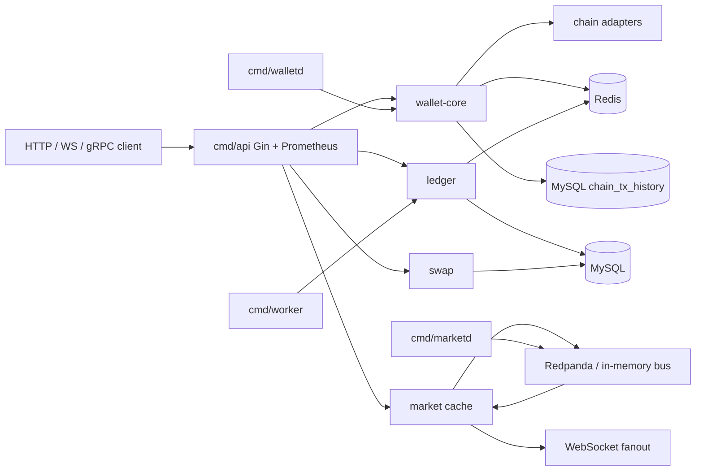
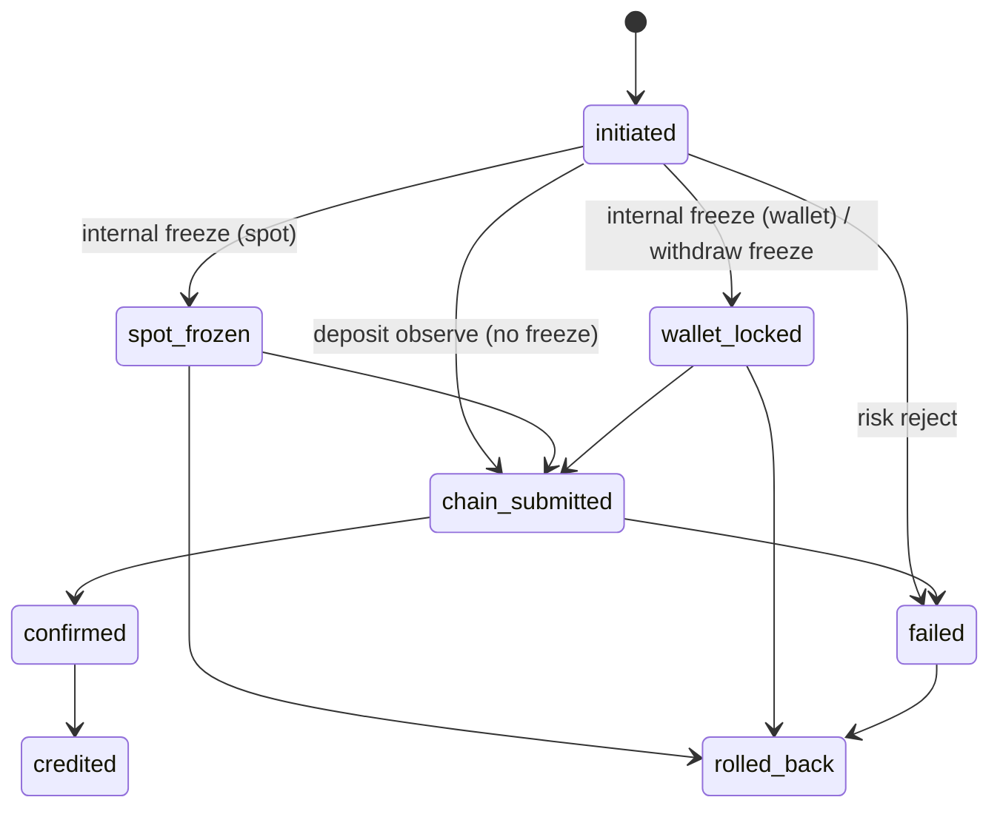

# Account and assets

Spot books and on-chain wallet share one process tree: decimal money, freeze-then-move, KYT fail-closed, chain RPC outside the database transaction. Architecture index: [`docs/README.md`](docs/README.md). Process map: [`docs/account-assets-architecture.md`](docs/account-assets-architecture.md).

Directory hosts are `*.kucoin.net`. Region CIDRs: SG `10.18.0.0/16`, TYO `10.19.0.0/16`. Chain RPC and explorer endpoints are configured in `configs/app.yaml` or `CHAIN_RPC_*` / `CHAIN_EXPLORER_*` (internal routing only).

HTTP, gRPC, and a backend WebSocket push endpoint. Design targets: [`docs/slo.md`](docs/slo.md), `GET /v1/slo`.

## Modules

| Module | Behavior |
| --- | --- |
| Wallet create/import | HD mnemonic create + import (AES at rest). EVM family (ETH, POLYGON, ARBITRUM, OPTIMISM, BASE) shares one derived address; BTC/SOL/TRON/TON stay chain-specific. Balance + tx history via RPC adapters with failover. `GET /v1/wallet/balances?view=unified` aggregates spot + wallet books per asset. Submitted txs persist to MySQL `chain_tx_history` (or the in-memory adapter). |
| Spot ↔ wallet | Same-user book move: freeze source, credit dest in one lock, no chain. `spot_to_wallet` / `wallet_to_spot`. Reconcile checks both books. Allowlist does not apply. |
| On-chain withdraw / deposit | `wallet_withdraw`: freeze wallet → decrypt destination (SQL stores ciphertext only) → submit → persist hash → confirmed credit consumes frozen only. Allowlist + chain + `to_address`; EVM family shares a bound address. `wallet_deposit`: observe inbound hash → unique `(chain, tx_hash)` → confirm → credit wallet from `system.bridge`. |
| On-chain swap | Quote from the same spot ticker cache as market push; execute submits a chain tx, then credits wallet books and `system.fee`. Partial/fail unfreeze is consistent. |
| Wallet market | Spot ticker and 1m K-line from one producer. Path: Kafka (or memory bus) `market.ticks` + `market.klines` → in-memory/Redis cache → backend WebSocket. No SQL on the hot path. |
| Nodes + services | RPC pick by availability/latency/failures + circuit/failover + retry. Binaries `api` / `walletd` / `marketd` / `worker`. Logs, Prometheus `/metrics`, `X-Trace-Id`, `/readyz`. |

## Architecture



Transfer state machine (on-chain withdraw / deposit). Internal spot↔wallet still walks freeze→submit→confirm→credit inside one DB transaction with an `internal:{id}` hash (no RPC).



## How to run

Prerequisites: Go 1.22+, Docker Compose (MySQL / Redis / Redpanda). `protoc` is only needed if you regenerate `api/proto`.

```bash
cp .env.example .env
make up # infra: MySQL / Redis / Redpanda on compose published ports
make up-apps # optional: containerized api/walletd/marketd/worker
make migrate # apply migrations/*.sql (seeds seed_user_id)
make run-api # HTTP :18480 (query-gateway.kucoin.net) and gRPC :18481
make test # in-process tests
make e2e # requires a running API
```

`GET https://query-gateway.kucoin.net/` returns a JSON API catalog. `/v1/*` requires `Authorization: Bearer` using `auth.bearer_tokens` in `configs/app.yaml`. `/healthz`, `/readyz`, `/metrics` stay public.

```bash
make test
# 逻辑单测与流程单测不依赖新加坡/东京实网。
# go test ./internal/callerid ./internal/tradepw ./internal/fundsurf ./internal/kcfund ./internal/cvfund ./internal/exjob ./tests/flow
```


Account/asset processes (compose profile `apps`):

| Process | Internal endpoint |
| --- | --- |
| account-service | https://account-book.kucoin.net |
| ledger-service | https://ledger-transfer-freeze-reconciliation.kucoin.net |
| deposit + withdraw | https://deposit-withdraw.kucoin.net |
| address-service | https://address.kucoin.net |
| custody-service | https://custody-boundary-lab.kucoin.net |
| kyt-service | https://kyt.kucoin.net |
| query-gateway | https://query-gateway.kucoin.net |
| fund-surface / security | https://fund-surface.kucoin.net / https://security.kucoin.net |
| convert | https://convert.kucoin.net |
| statement-export | https://statement-export.kucoin.net |
| sub-account | https://sub-account.kucoin.net |

If Compose image extract fails, run MySQL 8 and Redis 7 on the intra hosts in `.env.example` and keep `KAFKA_OPTIONAL=true` (in-memory bus). The process already falls back from `13306`→`3306` and `16379`→`6379`.

Other binaries: `make run-grpc`, `make run-market`, `make run-worker`. Split processes: `PROCESS_ROLE=api|worker|market|wallet`. Default `all` keeps a single `cmd/api`.

### Compose-based tests

```bash
make up && make migrate
go test ./tests/integration -tags=integration -count=1
```

Unit tests for the ledger state machine and the in-memory HTTP/gRPC stack do not need Docker (`make test`).

## HTTP surface

Catalog: `GET /` (JSON endpoint list).

```bash
curl -s https://query-gateway.kucoin.net/healthz
curl -s -H 'Authorization: Bearer REPLACE_ME' \
 https://query-gateway.kucoin.net/v1/balances?user_id=user-10001
curl -s -X POST https://account-book.kucoin.net/v1/accounts/open \
 -H 'Authorization: Bearer REPLACE_ME' \
 -H 'Content-Type: application/json' \
 -d '{"user_id":"user-10001","book":"trading"}'
curl -s -X POST https://ledger-transfer-freeze-reconciliation.kucoin.net/v1/ledger/transfers \
 -H 'Authorization: Bearer REPLACE_ME' \
 -H 'Content-Type: application/json' \
 -d '{"user_id":"user-10001","direction":"spot_to_wallet","asset":"USDT","amount":"12.5","chain":"ETH","to_address":"0x1111111111111111111111111111111111111111","idempotency_key":"seed-1","wait":true}'
curl -s -H 'Authorization: Bearer REPLACE_ME' \
 'https://ledger-transfer-freeze-reconciliation.kucoin.net/v1/ledger/reconcile?user_id=user-10001'
curl -s -X POST https://kyt.kucoin.net/v1/kyt/screen \
 -H 'Authorization: Bearer REPLACE_ME' \
 -H 'Content-Type: application/json' \
 -d '{"user_id":"user-10001","chain":"ETH","to_address":"0x1111111111111111111111111111111111111111","asset":"USDT","amount":"10"}'
```

- `POST /v1/wallet/create` `POST /v1/wallet/import` `GET /v1/wallet/list` `GET /v1/wallet/chains`
- `GET /v1/wallet/balances` `GET /v1/wallet/balances?view=unified` `GET /v1/wallet/tx-history` `GET /v1/wallet/nodes/health`
- `GET /v1/wallet/address-book` `POST /v1/wallet/address-book` `DELETE /v1/wallet/address-book` — user allowlist used by `wallet_withdraw`
- `GET /v1/wallet/deposit-address?chain=` — derived inbound address; listed chains here have no memo/tag
- `POST /v1/ledger/transfers` — `spot_to_wallet` / `wallet_to_spot` (internal); `spot_send` (funding book, user→user); `wallet_withdraw` / `wallet_deposit` (on-chain). `wait: true` confirms when a chain tx is involved; internal always settles in the same lock.
- `POST /v1/ledger/transfers/:id/cancel` — unfreeze only if the chain hash is not live
- `GET /v1/ledger/bills` — user journal lines
- `POST /v1/ops/users/freeze` — risk freeze; new movements fail closed
- `POST /v1/spot/orders` `GET /v1/spot/orders` `DELETE /v1/spot/orders/:id` `GET /v1/spot/depth` `GET /v1/spot/trades` — in-process price-time book + house backstop for leftover market IOC. Not a matching-engine cluster.
- `POST /v1/ops/inbound` — inject an inbound hash and scan-credit `wallet_deposit`. Indexer URL comes from config.
- `POST /v1/ops/users/kyc` — levels `none` / `basic` / `advanced`. Missing row is `basic`.
- `POST /v1/ops/sweep` `GET /v1/ops/kms` `GET /v1/futures/contracts` — desk hot→cold park; PKCS#11 or cloud KMS ECDSA; empty futures catalog (no engine).
- `POST /v1/ledger/transfers` — also `fiat_onramp` / `earn_subscribe` / `earn_redeem` / `hot_cold_sweep` (book hops).
- `GET /v1/ledger/transfers` `GET /v1/ledger/transfers/:id` `GET /v1/ledger/accounts` `GET /v1/ledger/statement` `GET /v1/ledger/reconcile` `GET /v1/ledger/audit`
- `POST /v1/swap/quote` `POST /v1/swap/execute` `GET /v1/swap/orders`
- `GET /v1/market/ticker` `GET /v1/market/klines?symbol=ETH-USDT` `GET /v1/market/lag` `GET /v1/market/ws` (backend push)
- `GET /v1/connectivity` process graph + ID dictionary; `GET /v1/events` outbox (`wallet.movements`)
- `GET /v1/slo` design targets + live process snapshot; `GET /v1/ops/alerts` firing rules (`deploy/alerts.yml`)

gRPC: `WalletService` in `api/proto/wallet/v1/wallet.proto` (wallet, transfers, swap, address-book, accounts).

Seed user `user-10001` is loaded with spot and wallet balances. Allowlisted addresses live in `migrations/0001_init.sql`.

## Fund-safety notes

- **Books**: per-user `spot` / `wallet` available+frozen, plus `system.bridge` (internal hop / chain park / deposit pool) and `system.fee`. Spot and wallet are separate books; internal moves freeze-then-credit in one lock. On-chain withdraw never credits spot. Deposit credits wallet only after confirm, with no user freeze.
- **Journal**: every movement is balanced per asset. Freeze is available→frozen; internal/deposit credit crosses the bridge onto the dest book; withdraw consume_frozen parks on the bridge. Rollback unfreezes when a freeze exists.
- **No negative balances**: application checks plus MySQL `CHECK (available >= 0)`.
- **Idempotency**: unique `idempotency_key` on transfers and swap orders; replays return the original row. HTTP maps payload conflicts to 409 via `internal/apierr`.
- **Locks**: Redis `SET NX` + Lua compare-and-del / compare-and-PEXPIRE `Touch` on `lock:user:{id}`. If the Redis token is gone, submit is refused (`ErrBusy`) rather than racing a second freeze. Transfer and swap rows also carry `fence_epoch` / `fence_token` CAS so a stale worker cannot mutate.
- **Precision**: `ledger.ParseAmount` rejects scientific notation and >18 fraction digits. `DECIMAL(36,18)` / `shopspring/decimal`. JSON amounts are strings.
- **Risk (config-driven)**: max single, daily sum, min amount, velocity window; allowlist on withdraw only; `suspicious_amount` / `velocity_elevated` flags (flags do not reject). Chain/asset matrix rejects unlistable withdraw/deposit pairs. `POST /v1/ops/users/freeze` blocks new freezes for that user.
- **Audit**: `audit_log` for state changes and risk decisions; listable via HTTP.
- **Addresses at rest**: AES-256-GCM through PKCS#11 or cloud KMS (`internal/cryptoenc`). Production Open refuses a file keeper.
- **Reconcile**: `/v1/ledger/reconcile` and the worker job compare books vs in-flight freeze/credit/swap journals. Mismatches are written to `audit_log` and block new transfers/swaps until the report is clean.
- **Swap**: freeze wallet inventory before chain submit; submit failure unfreezes (idempotent). Frozen retries resume settlement. Quotes refuse stale live prints instead of falling back to a static book.
- **Spot ticker-fill / CLOB**: in-process price-time book plus a house backstop when the book is empty. This is not a matching-engine cluster.

See [`docs/architecture.md`](docs/architecture.md).

## Design targets

These are process design targets, not measured incident history. See [`docs/slo.md`](docs/slo.md).

| Target | Enforcement |
| --- | --- |
| Wallet-core HA aim 99.95% | `/healthz`, `/readyz` (MySQL/Redis or mem), graceful degrade on chain RPC, retry + circuit |
| Multi-chain query p99 ≤ 500ms | Redis cache, parallel fan-out, 180ms RPC timeout, 400ms query deadline |
| No silent book drift | Reconcile job + audit + movement block |
| Ticker/K-line push < 1s; stale ≤ 0.5% | Same spot feed; bus → memory/Redis → WS |
| Chain submit ≥ 99.9% | Prefer healthy low-latency nodes; failover + retry |
| Fast localization | Prometheus counters/histograms, structured logs, `X-Trace-Id`, `GET /v1/ops/alerts`, `deploy/alerts.yml` |

## Market latency

Hot path is produce → bus (`market.ticks` / `market.klines`) → in-memory last-tick + 1m candle map → WebSocket fan-out. Redis holds a short TTL copy. Sequence numbers drop stale ticks. No SQL on the tick/kline path. Swap quotes read this same ticker cache.

## Layout

Account & assets architecture: [`docs/architecture/overview.md`](docs/architecture/overview.md). Fund state machine: [`docs/architecture/fund-state.md`](docs/architecture/fund-state.md). Subject/book map: [`docs/architecture/book-subject.md`](docs/architecture/book-subject.md). Review: [`docs/architecture/account-assets-review.md`](docs/architecture/account-assets-review.md). Shared layers: [`docs/architecture.md`](docs/architecture.md).

```
cmd/ api, walletd, marketd, worker, plus account/asset process binaries
internal/ domain + httpapi + grpcsvc + app composition root
api/proto/ gRPC contracts
migrations/ MySQL schema + seed user
deploy/ docker-compose.yml + region overlays + alerts.yml
configs/ app.yaml + KEK path + account-assets.yaml
docs/ slo, architecture, product, engineering
```

Production Open requires SQL DSN, PKCS#11 or cloud KMS, configured JSON-RPC, and IAM JWKS when `AUTH_KIND=iam`.
