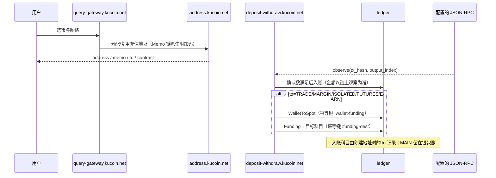
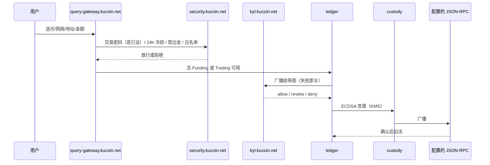
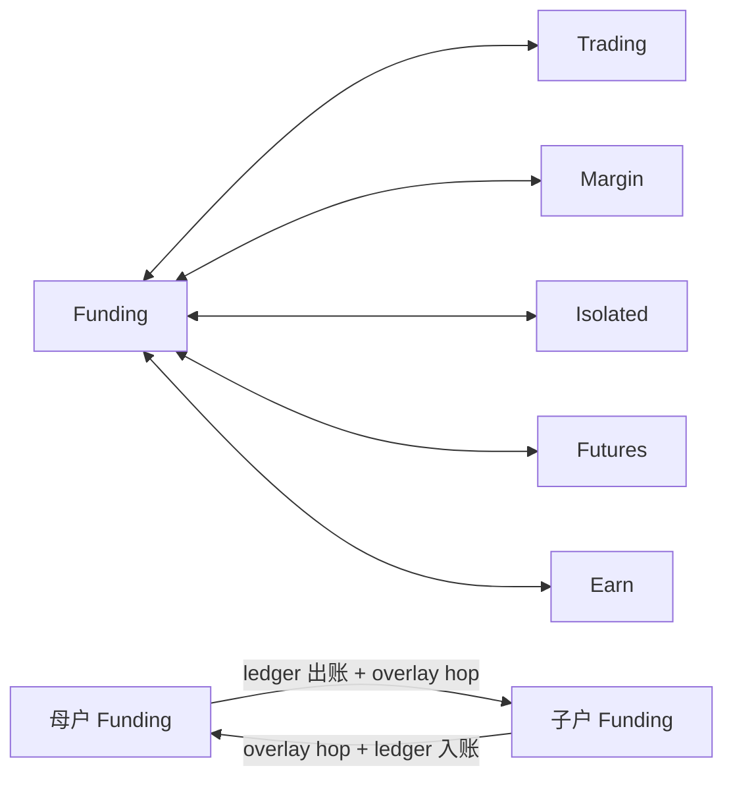
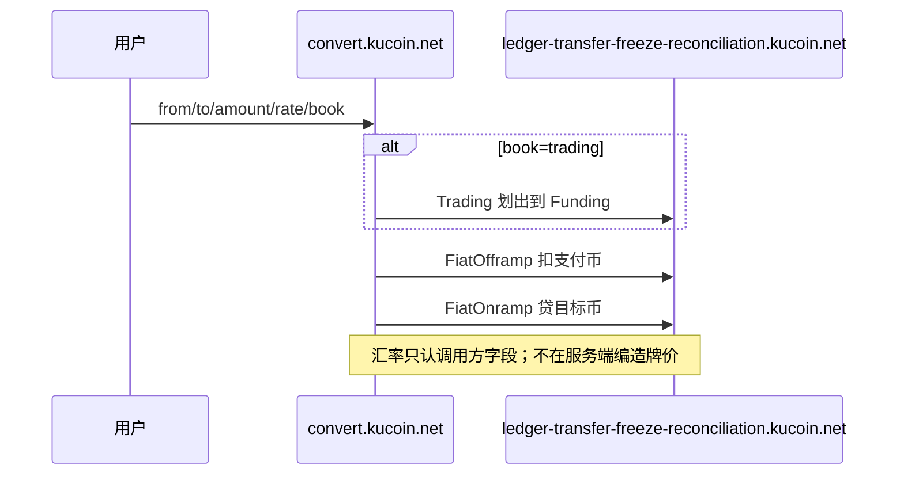
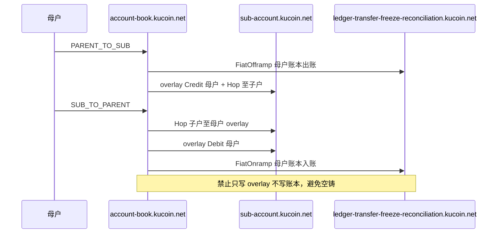

# 资金账户核心流程

本文描述用户资金主路径。目录主机与区域地址不变：`*.kucoin.net`，新加坡 `10.18.0.0/16` 主写，东京 `10.19.0.0/16` 灾备。公网 JSON-RPC 只从 `configs/app.yaml` 读取。

## 科目与入口

| 科目 | 用途 | 出金 | 划转 |
| --- | --- | --- | --- |
| Funding (`main`) | 存放、充提、P2P、内部转账 | 直接 | 可划入 Trading / Margin / Isolated / Futures / Earn |
| Trading (`trade`) | 现货占用 | 直接 | 可划回 Funding |
| Margin / Isolated / Futures / Earn | 占用账 | 须先划回 Funding | 只认 Funding 对端 |

## 充值

入账金额不得取自调用方自报字段。同一 `(chain, tx_hash, output_index)` 只入一次。重组低于确认深度则冲正，禁止二次入账。

## 提现

仅 Funding / Trading 可直接出金。内部转账按 UID / 邮箱 / 手机解析对手，走账本 `spot_send`，不上链。Pending 且未广播可取消。

## 账户间划转

母子划转禁止在 overlay 上空铸余额：出方向先冻母户账本，入方向先扣子户 overlay 再贷记母户账本。

## 安全闸

- 交易密码 6 位，哈希落盘，改/重置写入 `security_change`，出金页倒计时。
- 解冻、改绑、改密共用 `withdraw_cooling`。
- 用户禁出金与账户冻结分闸；配额接口返回 `USER_FORBIDDEN` / `SECURITY_LOCK`。
- 打开仅地址簿出金后，目标必须在地址簿或 `aa_dest_allow`。

## 闪兑与导出

闪兑牌价由调用方提供，账本做 Funding 借贷（必要时先 Trading→Funding）。导出窗口不超过 100 天，每日次数上限，正文由账本流水生成。

## 闪兑结算

## 母子划转

## 目录与区域

新加坡 `10.18.0.0/16` 主写，东京 `10.19.0.0/16` 备。主机 kebab-case `*.kucoin.net`，A 记录见 `configs/account-assets.yaml`。集群节点同前缀、末 octet 不同。公网 JSON-RPC 只从配置读取。
