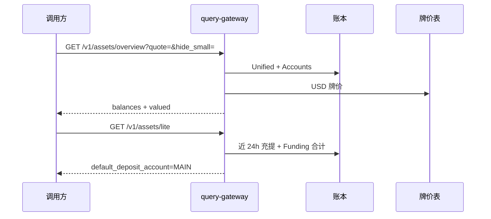
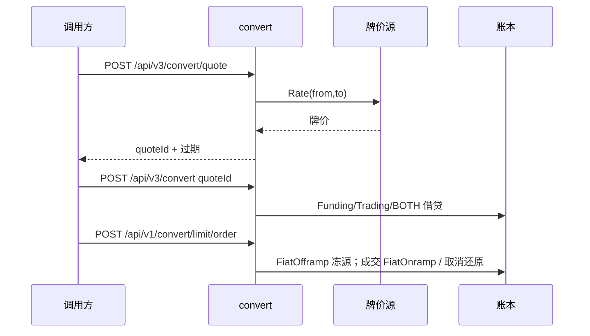

# 资金页业务流

本文对应 Assets / Funding 产品页的后端编排：科目怎么选、哪些闸在网关前、数据落在哪个包。前端交互不在范围内。

## 总览与 Lite

牌价缺行不得编造。USDT/USDC 无行时按 1 计。`hide_small` 按配置阈值丢掉报价后低于门槛的资产。

## 充值结果通知

入账 credited 后写入通知 outbox（`deposit.credited`）。下游通道由 `internal/notify` 消费；未配置凭证时保持 pending，不得标记 delivered。

## 出金验证组合

官网组合：手机+交易密码，或邮箱+TOTP+交易密码。`WITHDRAW_VERIFY_COMBOS` 配置，验证器可插拔。未配置时保持「已设交易密码则必核」。挑战码落 KV，明文只在 mem 档回显。

## 闪兑询价

档不得只带调用方汇率。牌价源失败即关。限价未成交保持冻结分类 `convert_limit`。BOTH 先补资金账再补交易账。

## Add Funds

厂商基址：`api.moonpay.com` / `api.banxa.com` / `api.circle.com`。确认必须带 HMAC 签名，未签名不得入账。

## P2P 资金占用

买入走 `P2PCredit`（幂等 `p2p-buy:{order_id}`）入 Funding。卖出与商家保证金走 `P2PDebit` 入 bridge，并写入 `p2p_sell` / `p2p_merchant_margin` 标签；用户 Frozen 不加这类 park。

资金页读面：`GET /v1/assets/p2p/holds` 仅开放标签；`/details` 含已释放与账本匹配；`/flow` 按幂等前缀分类流水；`/merchant*` 只解释商家保证金。盘口撮合不在本仓。对账只读（`/integrity`），不 Release、不补 Credit。
