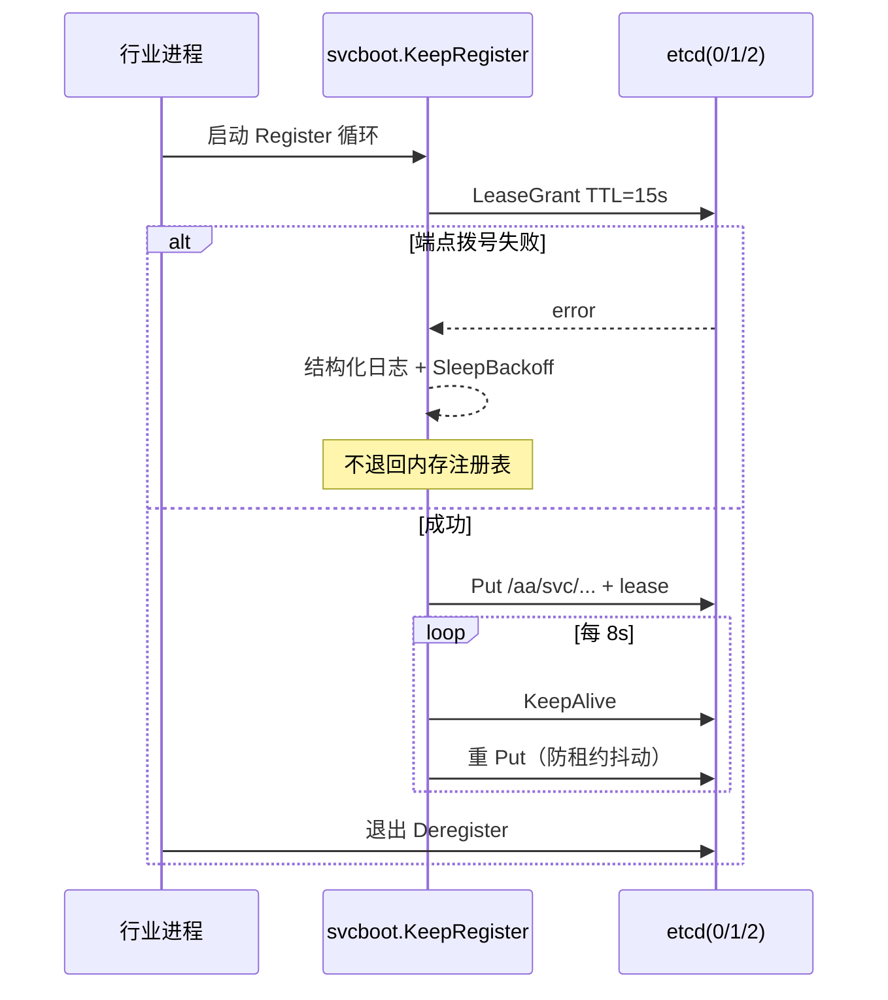
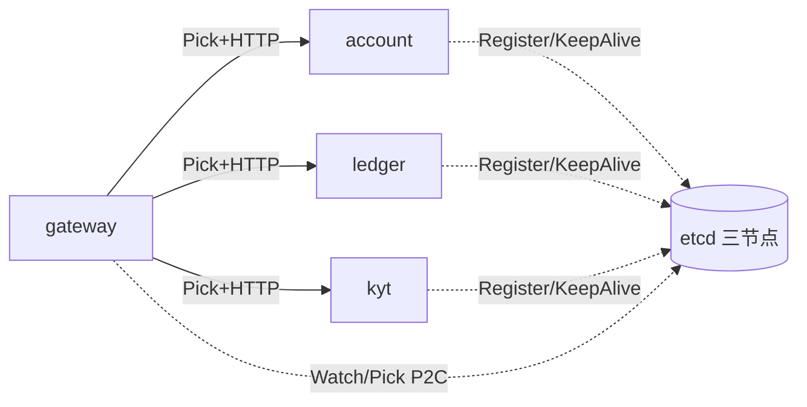

# Account & Assets 微服务落点

资金能力按现有进程骨架拆到微服务。目录主机与区域地址沿用 `*.kucoin.net`；本文件只写仓库落点与进程映射。

## 设计与资料

- https://docs.platform.kucoin.local/vendor/go-zero/guides/microservice/service-discovery/
- https://docs.assets.kucoin.local/ext/zeromicro/go-zero
- https://docs.platform.kucoin.local/vendor/go-zero/components/queue/kafka/
- https://docs.assets.kucoin.local/ext/safeheron/safeheron-api-sdk-go
- https://custody-vendor.kucoin.local/safeheron/ops/deposit-withdrawal-wallet
- https://docs.assets.kucoin.local/ext/wmh/custodial-wallet
- https://docs.assets.kucoin.local/architecture/account-assets/ledger-cookbook
- https://kb.wallet.binance-internal.local/architecture/custody-monorepo-layout
- https://kb.wallet.okx-internal.local/architecture/funding-ledger-boundary

## 模块与仓库布局

资金域在 **Java 单体时代** 的产品与账本写读混部，已升级为 **Java 产品/编排大仓（J1–J9）+ 本 Go 大仓（G1–G12）** 并行。

- Go module：`account-assets.kucoin.net/funding`
- 单仓约定（go-zero / 常见 CEX monorepo）：`cmd/<service>/main.go` + `internal/<service>/...`，共享库 `pkg/`（如 `pkg/money`）
- 行业进程根：`cmd/account`、`cmd/ledger`、`cmd/deposit`、`cmd/withdraw`、`cmd/address`、`cmd/custody`、`cmd/kyt`、`cmd/gateway`
- 历史二进制名（`*-service` / `query-gateway`）保留为部署兼容别名，装配与行业名一致

## 服务与目录主机

| 服务 | 目录主机 | 进程（行业名 / 兼容别名） | 包根 | 职责 |
| --- | --- | --- | --- | --- |
| account-book | `account-book.kucoin.net` | `cmd/account` / `cmd/account-service` | `internal/account` | 多科目开闭冻、hop、Funding/Trading/Margin/Isolated/Futures/Earn 划转 |
| funding-ledger | `ledger-transfer-freeze-reconciliation.kucoin.net` | `cmd/ledger` / `cmd/ledger-service` | `internal/ledgersvc`（领域 `internal/ledger`） | 分录、冻结、流水、对账、手续费 |
| deposit-withdraw | `deposit-withdraw.kucoin.net` | `cmd/deposit`·`cmd/withdraw` / `cmd/deposit-service`·`cmd/withdraw-service` | `internal/deposit` · `internal/withdraw` | 链上充值观察、链上出金、内部转账、安全冷却 |
| address | `address.kucoin.net` | `cmd/address` / `cmd/address-service` | `internal/address` | 充值地址、地址簿 |
| custody | `custody-boundary-lab.kucoin.net` | `cmd/custody` / `cmd/custody-service` | `internal/custody` | 托管审批、仪式/法定人数、热额边界 |
| risk-kyt | `kyt.kucoin.net` | `cmd/kyt` / `cmd/kyt-service` | `internal/kytsvc`（引擎 `internal/kyt`） | 筛查、案件、`kyt.hit` |
| query-gateway | `query-gateway.kucoin.net` | `cmd/gateway` / `cmd/query-gateway` · `cmd/api` | `internal/gateway` | 总览、账单、聚合查询 |
| transfer-recon | `ledger-transfer-freeze-reconciliation.kucoin.net` | `cmd/recon-worker` / ledger | `internal/ledger` · recon | 科目划转复核对账；worker 周期 SweepStrandedCovers + RecoverOpenHops |
| fund-surface | `fund-surface.kucoin.net` / `security.kucoin.net` | `internal/fundsurf` / `internal/tradepw` | 同左 | 冻结明细、出金锁、交易密码、禁出金、Memo 工单、仅地址簿出金 |
| convert | `convert.kucoin.net` | `internal/cvfund` | 同左 | 闪兑结算；牌价由调用方提供 |
| statement-export | `statement-export.kucoin.net` | `internal/exjob` / `cmd/stmt-export` | 同左 | 充提/账本导出，窗口 100 天 |
| sub-account | `sub-account.kucoin.net` | `internal/subacct` / `kcfund` hop | 同左 | 母子划转；overlay 落 KV；Hydrate 按 ListAfter 游标翻完；aborting 记 CompPhase；worker 自动 RecoverOpenHops |
| notify (in-process) | — | `internal/notify` | 同左 | 出金挑战/入金结果 outbox；独立 notify-worker 已迁出 |
| config-center | `config-center.kucoin.net` | `internal/cfgwatch` / `internal/cfgcenter` | 同左 | 配置前缀 `/aa/cfg/` |

Java 产品/编排面（J1–J9）独立大仓部署，目录主机见 `internal/config/hosts.go`（`user-account` / `funding-bff` / `fee-vip-rebate` 等）；Go 侧经 `internal/platformjava` + `internal/svcdial` 按 etcd 名调用，边界见 `java-go-package-boundary.yaml`。

注册名与行业进程名一致（兼容别名仍可用历史名）。发现走 etcd 三节点（`etcd-0/1/2.kucoin.net:2379`）。配置中心与注册中心共用 etcd 集群，另挂 `config-center.kucoin.net` 作为逻辑主机。SG/TYO 双区目录主机表见 `internal/config/hosts.go`（`10.18` / `10.19`）。

## 能力 → API

| 能力 | 服务 | 接口 / 包 |
| --- | --- | --- |
| 多账户总览 | query-gateway | `GET /v1/assets/overview`；`GET /v1/balances`；`GET /v1/accounts` |
| Funding/Trading/Margin/Isolated/Futures/Earn 科目 | account-book | `POST /v1/accounts/open-all`；`GET /v1/accounts`；`GET /v1/accounts/book/:book`；Classic v3 全仓/逐仓 REST |
| 账户间划转 | account-book | `POST /v1/accounts/transfers`；`GET /v1/accounts/hops` |
| 链上充值 | deposit-withdraw | `POST /v1/deposits/observe`；`GET /v1/deposits` |
| 链上出金 | deposit-withdraw | `POST /v1/withdrawals`；`POST /v1/withdrawals/:id/cancel` |
| 内部转账 UID/邮箱/手机 | deposit-withdraw | `POST /v1/withdrawals/internal` → `internal/fundint` + `internal/userdir` |
| 地址簿 | address-custody | `GET/POST/DELETE /v1/wallet/address-book`；`GET /v1/addresses/book` |
| 充值地址 | address-custody | `GET /v1/wallet/deposit-address`；`GET /v1/addresses/deposit` |
| 充提历史 | query-gateway / asset-ops | `GET /v1/bills`；`GET /v1/movements`；`GET /v1/stmt` |
| 历史导出作业 | asset-ops | `POST /v1/ops/exports`；`GET /v1/ops/exports/:id`；`GET /v1/bills/export`；`GET /v1/stmt/export` |
| 闪兑邻接 | asset-ops | `POST /v1/convert`；`GET /v1/convert`；`GET /v1/convert/:id`（牌价由调用方提供；账本借贷） |
| 冻结明细 | query-gateway | `GET /v1/assets/frozen`；`GET /api/v1/accounts/holds` |
| 出金锁倒计时 | deposit-withdraw | `GET /v1/security/withdraw-lock`；配额 `lockRemainSeconds` |
| 交易密码 | deposit-withdraw | `POST /v1/security/trading-password` |
| Memo 自助工单 | deposit-withdraw | `POST /v1/deposits/memo-recover` |
| 安全变更 24h 冷却 | deposit-withdraw / funding-ledger | `POST /v1/security/cooldown` → `ledger.MarkSecurityChange`；出金闸 `requireWithdrawCooling` |
| KYT | risk-kyt | `POST /v1/kyt/screen` |

Account & Funding REST 兼容面挂在各进程 HTTP 引擎：`/api/v1`、`/api/v3`、`/api/ua/v1`、`/api/ua/v2`，实现见 `internal/kcfund`，基线见 `aa-funding-api-baseline.md`。Classic 另含 `GET/POST /api/v1/deposit-addresses`、`GET /api/v2/deposit-addresses`、`GET /api/v1/hist-deposits`、`GET /api/v1/hist-withdrawals`、`POST /api/v1/withdrawals`、`POST /api/v1/accounts/inner-transfer`、`POST /api/v2/accounts/sub-transfer`。`user-info` 在 Java 门户。既有 `/v1/*` 资金写读面不删除。

## 进程间调用

- 注册：启动 `Register`，租约 15s，周期 `KeepAlive` / 重注册；退出 `Deregister`。
- 发现：watch 前缀 + P2C；也可 round-robin。
- 调用：`internal/svcdial` HTTP（gRPC 入口仍挂本进程）。拨号失败结构化日志 + 退避重试，不把失败写成 200。
- 配置：`internal/cfgwatch` 前缀 `/aa/cfg/<ns>/<env>/`。

 `ETCD_ENDPOINTS` 为空则 `RefuseProduction` 失败即关。端点已配但拨号失败：日志 + 重试，不退回内存注册表。

## 注册生命周期

## 进程间拨号

网关业务路径见 `internal/gateway/remote.go`：`GET /v1/remote/overview`、`POST /v1/remote/kyt/screen`、`GET /v1/remote/health/:service`。拨号实现 `internal/svcdial`（超时、重试、熔断钩子）。
