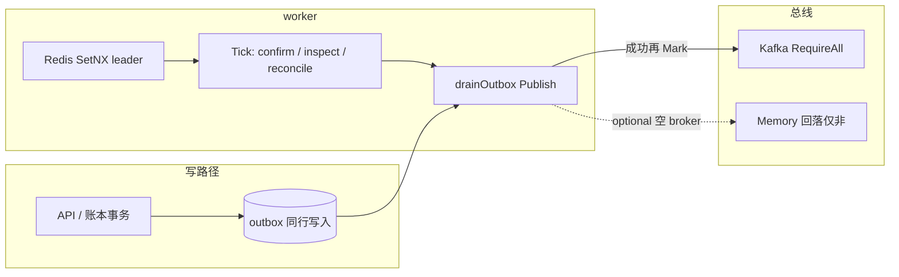
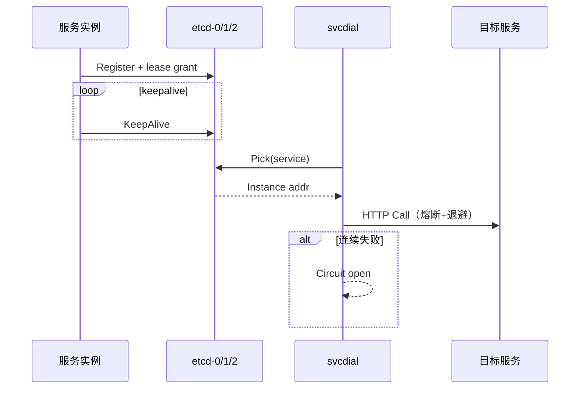

# Account & Assets 中间件拓扑

资金异步、缓存/幂等/锁、关系库主从。节点数与主题依据平台中间件规范编排（Kafka / Redis / MySQL 或 Postgres / etcd）。目录主机与区域地址不变：`*.kucoin.net`。内部私网：新加坡 `10.18.0.0/16` 主写，东京 `10.19.0.0/16` 灾备读；中间件与库集群地址仅使用上述网段。

编排见 `deploy/compose-middleware.yml`。中间件各有目录主机：`etcd-0/1/2`、`mysql-0/1`、`redis-0/1/2`、`kafka-0/1/2`、`pg-0/1`。同集群节点共用前缀、末 octet 不同。

## 参考

- https://docs.platform.kucoin.local/vendor/go-zero/guides/microservice/service-discovery/
- https://docs.assets.kucoin.local/ext/zeromicro/go-zero
- https://docs.platform.kucoin.local/vendor/go-zero/components/queue/kafka/
- https://docs.assets.kucoin.local/ext/zeromicro/go-zero/pull/5438
- https://docs.platform.kucoin.local/vendor/kafka/kraft-operations
- https://docs.platform.kucoin.local/vendor/kafka/zk-migration-notes
- https://docs.platform.kucoin.local/vendor/redis/cluster-scaling
- https://docs.platform.kucoin.local/vendor/redis/sentinel-ops
- https://docs.platform.kucoin.local/vendor/mysql/8.0/replication
- https://docs.platform.kucoin.local/vendor/postgresql/16/warm-standby
- https://docs.platform.kucoin.local/vendor/etcd/v3.5/clustering
- https://docs.platform.kucoin.local/vendor/etcd/v3.5/learning/api/
- https://docs.assets.kucoin.local/ext/xxRanger/go-crypto-exchange
- https://docs.assets.kucoin.local/ext/TradeOrders
- https://custody-vendor.kucoin.local/safeheron/blog/crypto-exchange-wallet-infrastructure/
- https://custody-vendor.kucoin.local/safeheron-dev/quickstart_tutorials/auto_sweep
- https://docs.assets.kucoin.local/ext/wmh/custodial-wallet

## 节点与模式

| 组件 | 模式 | 节点 | 目录主机与端口 | SG | TYO |
| --- | --- | --- | --- | --- | --- |
| etcd | 3 节点，v3 gRPC | 3 | `etcd-0/1/2.kucoin.net:2379` | `10.18.0.10` / `.14` / `.15` | `10.19.0.10` / `.14` / `.15` |
| Kafka | KRaft 3 broker（无 ZooKeeper）。ZooKeeper 3+Kafka 3 为备选编排，默认不启 | 3 | `kafka-0/1/2.kucoin.net:9092` | `10.18.0.20` / `.22` / `.23` | `10.19.0.20` / `.22` / `.23` |
| Redis | Sentinel（1 主 2 从 + 3 sentinel）。6 节点 cluster 见下表，默认 Sentinel | 6 角色 | `redis-0.kucoin.net:6379` 主；`redis-1/2` 从 | `10.18.0.12` / `.13` / `.16` | `10.19.0.12` / `.13` / `.16` |
| MySQL | 1 主 + 1 从 | 2 | `mysql-0.kucoin.net:3306` 主；`mysql-1.kucoin.net:3306` 从 | `10.18.0.40` / `.41` | `10.19.0.40` / `.41` |
| Postgres | 1 主 + 1 从 | 2 | `pg-0.kucoin.net:5432` 主；`pg-1.kucoin.net:5432` 从 | `10.18.0.4` / `.5` | `10.19.0.4` / `.5` |

注册中心只用 `etcd-0/1/2:2379`。Redis 逻辑主机为 `redis-0.kucoin.net`，Kafka 为 `kafka-0.kucoin.net`。`jaeger.kucoin.net` 只做追踪，`risk-portal.kucoin.net` 只做风控入口。

### Redis 6 节点 cluster（备选）

3 主 3 从：`redis-0/1/2.kucoin.net` 各开 cluster 总线端口。SG `10.18.0.12` / `.13` / `.16`，TYO 同末 octet。默认 compose 走 Sentinel。

### Kafka ZooKeeper 备选

KRaft 为默认（3 controller+broker）。若运维要求 ZK：3 ZooKeeper + 3 broker，仍挂 `kafka-0/1/2.kucoin.net`。

## 主题

账本 journal 仍是入账权威。主题只通知：

| Topic | 者 | 消费者 |
| --- | --- | --- |
| `deposit.credited` | deposit-withdraw | query-gateway / notify |
| `withdraw.requested` | deposit-withdraw | risk-kyt / custody |
| `ledger.posted` | funding-ledger | recon / query |
| `recon.diff` | transfer-recon | ops / war-room |
| `kyt.hit` | risk-kyt | withdraw / aml-desk |

常量在 `internal/bus`：`TopicDepositCredited`、`TopicWithdrawRequested`、`TopicLedgerPosted`、`TopicReconDiff`、`TopicKYTHit`。

## 客户端约定

- Kafka：`KAFKA_BROKERS=kafka-0.kucoin.net:19092`（发布端口）或集群内 `:9092`。缺 broker 且非 `KAFKA_OPTIONAL` 则 `RefuseProduction`。投递 `RequireAll`；投递失败不伪造成功。出箱仍先落库再 mark published。
- Redis：缓存、幂等键、用户锁。锁失败即关，不跳过锁写账。
- SQL： `MYSQL_DSN` 或 `ACCOUNT_ASSETS_PG_DSN` 必填。读可走从库；写走主库。
- etcd：`ETCD_ENDPOINTS=http://etcd-0.kucoin.net:2379`。缺省失败即关。进程用 gRPC 连 2379，不走 HTTP JSON 网关。

区域叠加不改主机名：TYO 复用同一 `*.kucoin.net`，以 `internal/ha` 围栏区分写权。多 AZ：SG 主写，TYO 副本；角色副本与反亲和见 `aa-k8s-topology.md`。组件对应见 `aa-platform-selection.md`。

## 连接与热路径

- 池：`persist.PoolSettings` 默认 MaxOpen 16 / MaxIdle 8。
- 超时：HTTP 拨号 `svcdial` 三次退避；SQL / Redis 超时走配置。
- 幂等：划转 `clientOid`、充提 `idempotency_key`。
- outbox：账本 journal 权威，Kafka 只通知。
- bench：`internal/kcfund` ledger / transfer / isolated / deposit / withdraw / address。

## Worker 与出箱

要点：

- Leader 键 `aa:funding:worker:leader`（出箱泵另键 `aa:funding:worker:leader:outbox`），TTL 8s，续期 3s；丢锁即停 Tick。
- Publish 失败不 Mark；毒丸经 `outbox.poison` 主题暴露。
- journal 仍是入账权威；Kafka 只通知。

## 服务发现与拨号

- `OpenEtcdFailover` 按 endpoints 顺序探测 grant。
- `svcdial.Guarded` 叠加 Circuit；打开返回错误，禁止空 200。
- 区位偏好 SG `10.18` / TYO `10.19`，写权仍归 `internal/ha`。

## 代码落点

| 能力 | 包 |
| --- | --- |
| 目录与就绪评估 | `internal/mwtopo` |
| etcd 注册/续租/failover | `internal/svcreg` |
| 拨号熔断 | `internal/svcdial` |
| Kafka / Memory 总线 | `internal/bus` |
| 出箱泵与 Kafka 投递 | `internal/outboxpump` |
| 设计目标 | `internal/slo`（含 middleware 段） |
| Worker 主循环 | `internal/app.RunWorker` / `cmd/worker` / `internal/workerloop` |
| Redis 门面 | `internal/redisx`（go-redis / Sentinel） |
| 健康汇总 | `internal/mwtopo.Summarize` / `MergeReady` |
| 中间件部署 | `docs/architecture/middleware-deploy.md` |

注册客户端对 `ETCD_ENDPOINTS` 多端点轮询切主；Put/KeepAlive 失败不写内存伪装。节点 IP 与目录主机见上文「节点与模式」表。
