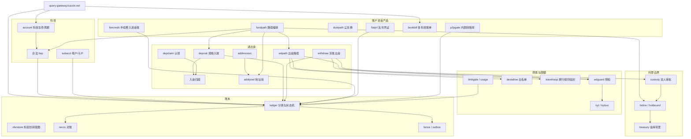
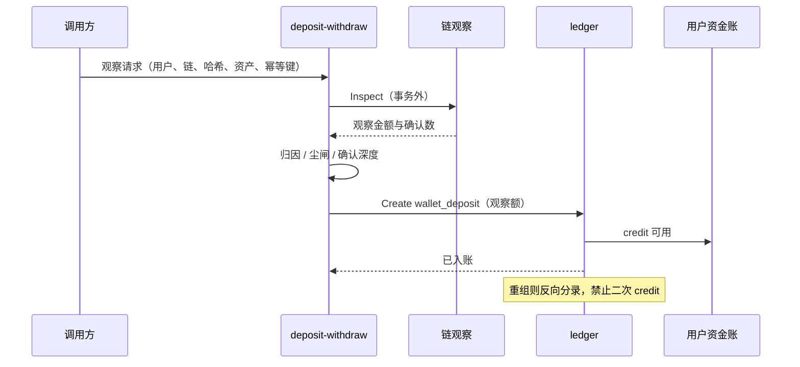
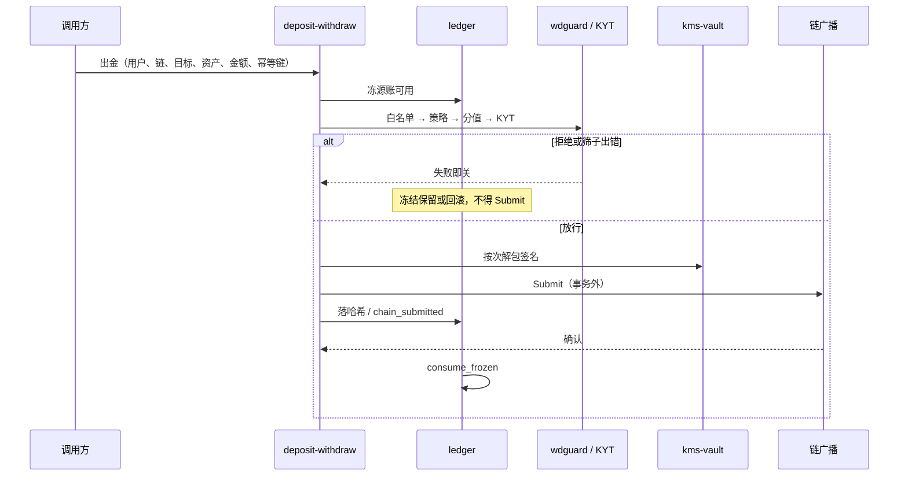
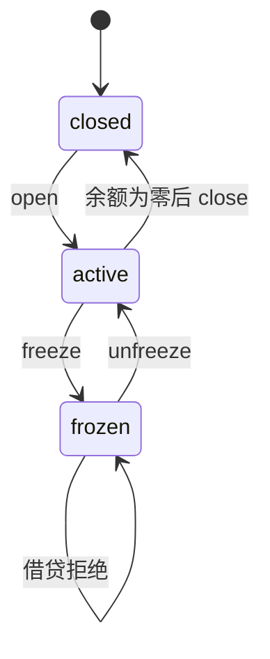

# 账户与资产

本文给出账户与资产模块划分、科目规则与资金主路径。实现位于 `internal/account`、`internal/ledger`、`internal/deposit`、`internal/withdraw` 及同级产品包。单据状态见 [资金单据状态机](fund-state.md)，科目与账本落点见 [科目与账本落点](book-subject.md)。落库与 `Open` / `OpenMem` 边界见 [持久化](persistence.md)。

## 模块图

查询网关聚合只读面。写路径按科目、账本、充提、地址、托管、筛查拆分。子账户、手续费入账、法币凭证、尘兑换、内部转账闸挂在账户或充提进程。

**账户与资产模块**

## 科目

| 科目 | 账本落点 | 说明 |
| --- | --- | --- |
| funding | spot | 默认已开；充提与内部 hop 的枢纽 |
| trading | trading | 只记账，不跑撮合 |
| margin | margin | 只记账，不跑强平 |
| futures | futures | 只记账，不跑合约引擎 |
| earn | earn | 申购/赎回 hop |

合法 hop 仅资金账与其余科目互转，科目之间不得直跳：

| 方向 | 账本 Direction |
| --- | --- |
| funding → trading | `funding_to_trading` |
| trading → funding | `trading_to_funding` |
| funding → margin | `funding_to_margin` |
| margin → funding | `margin_to_funding` |
| funding → futures | `funding_to_futures` |
| futures → funding | `futures_to_funding` |
| funding → earn | `earn_subscribe` |
| earn → funding | `earn_redeem` |

科目状态：`active` / `open` 可借贷；`frozen` 停进出；`closed` 要求可用与冻结均为零。funding 不得关闭。

子账户：母户冻则子户级联冻；解母户不解子户。子户之间 hop 拒绝，须经母户。子户出金/入金/划转受权限表约束。

## 账本方向（账户资金）

| Direction | 冻结 | 链 | 入账 |
| --- | --- | --- | --- |
| `wallet_deposit` | 无 | 观察并确认 | 用户 funding/wallet，金额来自观察 |
| `wallet_withdraw` | 源账可用 → 冻结 | 签名后广播 | 消耗冻结；现货科目不变 |
| `spot_to_wallet` / `wallet_to_spot` | 源账 | 无 | 同事务入对方账 |
| `spot_send` | 发送方 funding | 无 | 对手 funding |
| `funding_to_*` / `*_to_funding` | 源科目 | 无 | 目标科目，经桥 |
| `fiat_onramp` / `fiat_offramp` | 出金冻资金账 | 无 | 桥与资金账互转 |
| `hot_cold_sweep` | 无 | 无 | `system.bridge` → `system.cold` |

系统科目：`system.bridge`（热/桥）、`system.cold`（冷）、`system.fee`（手续费）。用户资金账不计入托管库存观察。

## 资金主路径

### 充值入账主路径

链上 `Inspect` 在事务外执行。入账额为观察量。`(chain, tx_hash)` 唯一；重复哈希冲突。确认深度按链策略。重组对已入账分录做反向流水，状态 `reorged`，不得二次 credit。尘阈值以下不得单独开入账。

**充值入账主路径**

### 提现广播主路径

先冻后筛。白名单、策略包、风险窗、KYT 任一步失败即关，不得 `Submit`。复审开案并保持冻结；过期复审不等于放行。签名按次解包。RPC 在事务外；先落哈希再标 `chain_submitted`。确认只消耗冻结。

**提现冻账至广播**

### 科目内部 hop

同一用户锁。冻源科目可用，经桥贷目标科目。`xferstore` 对同一幂等键锁定科目对与金额。源或目标冻结则拒绝。

**科目内部 hop**

### 冻结与解冻

科目级冻结停该科目借贷。用户级风控冻结阻断新开冻。可用→冻结、冻结→可用均为成对分录。关闭科目前余额必须为零。

**科目冻结**

## 路径编排

`internal/fundpath` 顺序串联：地址分配 → 归因绑定 → 观察入账 → 科目 hop → 出金白名单 / 旅行规则信封 / KYT / 预检 / 热账库存。任一步失败即关。已完成的入金不因后续出金闸失败而回滚。充提包不得反向依赖该编排包，以避免导入环。

## 资金安全闸

| 闸 | 行为 |
| --- | --- |
| `money.Parse` | 空串、科学计数、非正、超过 18 位小数拒绝 |
| `money.Balanced` | 按资产借贷合计相等 |
| `money.Conserve` | hop / 切费 / 入账两侧合计相等 |
| `persist.Fence` | epoch 只增；token 不匹配则 `ErrStaleFence` |
| 对账漂移 | 脏报告阻断新开划转 |
| 热账 cap | 超限或库存不可读则出金失败即关 |
| 停写 | halt / 无主 / 脑裂拒绝新写 |

手续费报价满足 fee + net = gross。返佣贷记资金账，受日限额约束。法币凭证在 KYC 未通过时拒绝。尘兑换按牌价组源资产借与 USDT 贷两套轧平分录。

旅行规则信封为工程校验（规范串与校验和），不构成持牌申报。KYT 为广播前筛查口，不构成持牌核验认证。
