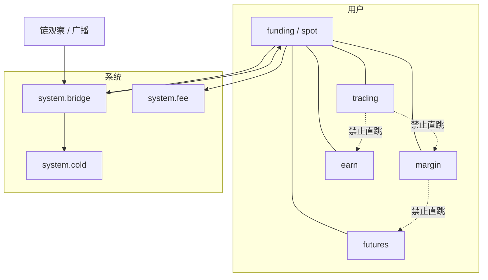
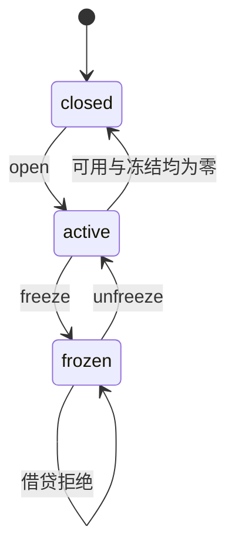

# 科目与账本落点

科目（subject）是账户产品面的资金分区；账本落点（book）是分录写入的账户类型。同一用户可持有多个科目，科目之间不得直跳，必须经资金科目或系统桥。

相关文档：[账户与资产](account-assets.md)、[资金单据状态机](fund-state.md)。

## 对应关系

| 科目 | 账本落点 | 可关闭 | 说明 |
| --- | --- | --- | --- |
| funding | spot | 否 | 默认已开；充提、内部转账、hop 枢纽 |
| trading | trading | 是 | 只记账，不承担撮合 |
| margin | margin | 是 | 只记账，不承担强平 |
| futures | futures | 是 | 只记账，不承担合约引擎 |
| earn | earn | 是 | 申购/赎回 hop |

系统科目不挂在用户下：

| 系统科目 | 账本落点 | 说明 |
| --- | --- | --- |
| `system.bridge` | 系统热/桥 | 充值对手、hop 中转、法币桥 |
| `system.cold` | 系统冷 | 热账超额归集目标 |
| `system.fee` | 系统手续费 | 出金/兑换/理财提前赎回罚金贷记（`fee_debit`） |

用户资金账不计入托管库存观察。热/冷库存快照写在 `aa_custody_inv`，按资产与 side（hot/cold）分行。

## 关系图

实线为合法 hop 或充提对手。虚线为拒绝边。

## 合法 hop

| 方向 | Direction | 冻结 | 入账 |
| --- | --- | --- | --- |
| funding → trading | `funding_to_trading` | 资金科目可用 | trading 可用 |
| trading → funding | `trading_to_funding` | trading 可用 | 资金科目可用 |
| funding → margin | `funding_to_margin` | 资金科目可用 | margin 可用 |
| margin → funding | `margin_to_funding` | margin 可用 | 资金科目可用 |
| funding → futures | `funding_to_futures` | 资金科目可用 | futures 可用 |
| futures → funding | `futures_to_funding` | futures 可用 | 资金科目可用 |
| funding → earn | `earn_subscribe` | 资金科目可用 | earn 可用 |
| earn → funding | `earn_redeem` | earn 可用 | 资金科目可用 |

同一用户锁。冻源科目可用，经 `system.bridge` 贷目标科目。`money.Conserve` 要求两侧合计相等。源或目标科目为 `frozen` 则拒绝。子户之间 hop 拒绝，须经母户。

## 科目生命周期

`active` / `open` 可借贷。`frozen` 停该科目进出。`closed` 要求可用与冻结均为零。funding 不得关闭。用户级风控冻结阻断新开冻，与科目级冻结叠加。

## 进出金落点

| 方向 | 用户科目 | 系统对手 |
| --- | --- | --- |
| `wallet_deposit` | funding / wallet 可用 | `system.bridge` 借 |
| `wallet_withdraw` | 源账冻结后消耗 | 链上目标；手续费可贷 `system.fee` |
| `spot_send` | 发送方 funding → 对手 funding | 无 |
| `fiat_onramp` | funding 贷 | `system.bridge` 借 |
| `fiat_offramp` | funding 冻后转出 | `system.bridge` |
| `hot_cold_sweep` | 无用户科目 | `system.bridge` → `system.cold` |

充值额只认链上观察量。`(chain, tx_hash)` 唯一，禁止两名用户认领同一哈希。
