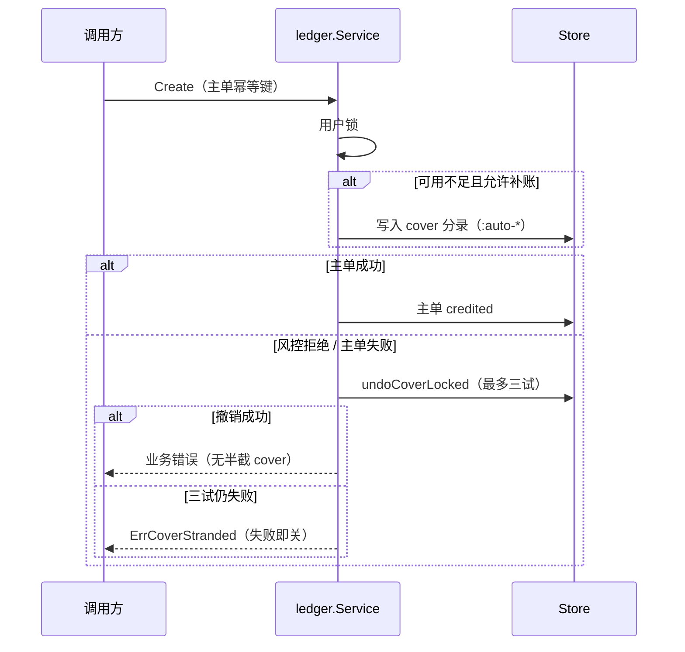
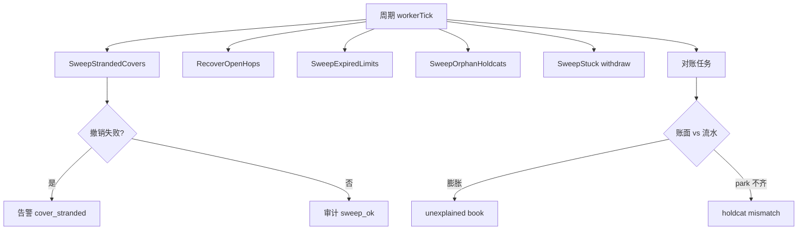

# 补账、清扫与对账

本文描述资金写路径上的自动补账（cover）、残留清扫与账面核对。实现见 `internal/ledger/cover.go`、`internal/ledger/reconcile.go`。

## 问题背景

部分写单要求资金落在指定科目（例如先钱包后现货）。可用不足时，服务在**同一用户锁内**从兄弟科目补划，再执行主单。补划与主单使用关联幂等键（主单键 + `:auto-s` / `:auto-w` / `:auto-t` 等后缀）。

若主单随后被风控拒绝或未落库，必须按补账单实额反转，禁止只记审计日志后放行半截 cover。

## 补账与主单

同幂等键再次 Create：先扫描残留 cover，清理后再开单。

## 后台清扫

`SweepStrandedCovers` 不依赖调用方重试：

1. 列出已 `credited` 且幂等键形如 cover 的分录。
2. 未过「锁 TTL + 时钟偏斜」的跳过，避免与在途 Create 竞态。
3. 主单仍有效则跳过；已有 `:undo` 成功则跳过。
4. 持用户锁撤销；三试失败打点 `aa_cover_stranded_total`、触发 `OnAlert("cover_stranded")`、写审计 `sweep_fail`。
5. 撤销后读己写，确认 undo 已 credited。

`BindFundsRecon` 将清扫、`RecoverOpenHops`、闪兑限价过期解冻（`cvfund.SweepExpiredLimits`）、孤儿 holdcat 标签释放（`kcfund.SweepOrphanHoldcats`，只 Release、不补 Credit）与出金广播卡住扫尾（`withdraw.SweepStuck` → `RecoverStuck`：signed-never-broadcast 解冻；live hash 永不自动解冻）挂入资金进程与 recon-worker 的周期任务。

## 对账要点

| 检查 | 规则 |
| --- | --- |
| 流水轧差 | 分录合计应解释账面；`Seed` 水位仅夹具允许 |
| 无流水膨胀 | 账面高于流水轧差 + Seed 记 `unexplained book above journal`； Seed 水位为 0 |
| bridge 占用 | 限价闪兑 / P2P 等 park 不抬用户 `Frozen`；对账核已入账借记与 `system.bridge_in` 是否匹配 |
| holdcat | 有标签无 park 日记记 mismatch；周期 `SweepOrphanHoldcats` 只 Release 孤儿标签 |

## 相关代码

- `internal/ledger/cover.go`
- `internal/ledger/reconcile.go`
- `internal/kcfund/hop.go` — `BindFundsRecon`
- `internal/cvfund/limit.go` — `SweepExpiredLimits`
- `internal/app/prod.go` — 缺 Redis/Kafka 等失败即关
