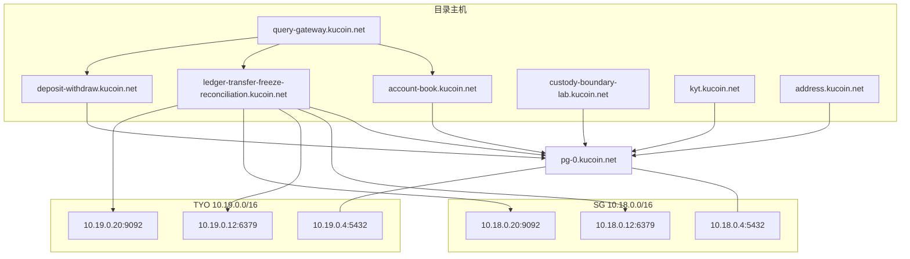
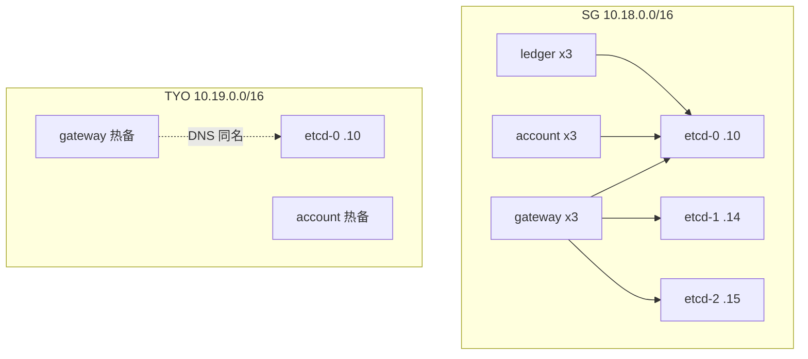

# 部署与双活

运行时主机只认目录表 `*.kucoin.net`。区域网段：SG `10.18.0.0/16`、TYO `10.19.0.0/16`。数据库逻辑主机名为 `pg-0.kucoin.net`，不使用公有云地域名作为目录主机。

## 目录主机

| 主机 | 进程角色 |
| --- | --- |
| `account-book.kucoin.net` | 科目开闭冻、hop、子账户 |
| `ledger-transfer-freeze-reconciliation.kucoin.net` | 划转、冻结、流水、对账、手续费入账 |
| `deposit-withdraw.kucoin.net` | 充值观察、提现预检与广播、法币凭证、出金路径 |
| `address.kucoin.net` | 充值地址、地址池、出金地址册 |
| `custody-boundary-lab.kucoin.net` | 热冷边界、双人审批、典礼状态机 |
| `kyt.kucoin.net` | 筛查、案件、审计 |
| `query-gateway.kucoin.net` | HTTP/gRPC 入口、统一查询、多科目账单 |
| `kms-vault.kucoin.net` | 密钥解包通道 |
| `iam-gateway.kucoin.net` | 签发与 JWKS |
| `pg-0.kucoin.net` / `pg-1.kucoin.net` | 关系库主从 |
| `mysql-0.kucoin.net` / `mysql-1.kucoin.net` | MySQL 主从 |
| `etcd-0.kucoin.net` / `etcd-1` / `etcd-2` | 注册与配置 |
| `redis-0.kucoin.net` / `redis-1` / `redis-2` | 缓存与锁 |
| `kafka-0.kucoin.net` / `kafka-1` / `kafka-2` | 通知总线 |
| `jaeger.kucoin.net` | 追踪 |
| `risk-portal.kucoin.net` | 风险门户 |

存活探测：`GET /healthz`。就绪：`GET /readyz`（依赖库或内存仓储）。指标：`GET /metrics`。写接口需要 `Authorization`；运维写另需角色头。

## 区域地址

| 区域 | CIDR | PostgreSQL | Redis | Kafka |
| --- | --- | --- | --- | --- |
| sg | `10.18.0.0/16` | `10.18.0.4:5432` | `10.18.0.12:6379` | `10.18.0.20:9092` |
| tyo | `10.19.0.0/16` | `10.19.0.4:5432` | `10.19.0.12:6379` | `10.19.0.20:9092` |

DSN 形态：`postgres://aa@<区域地址>/aa?host=pg-0.kucoin.net`。连接池档：SG `ProfileSG`，TYO `ProfileTYO`。中间件地址是编排地址，不是公网入口。

**双区部署**



## 写围栏

`internal/ha.Pair`：同一服务同一时刻仅一个写区。prefer 区竞选失败才由备用区上。两侧同时自称主则标脑裂、卸写，后续写返回失败即关。行级 `Fence` 与选主围栏独立：即使进程仍持主，过期 token 也不得改行。

用户锁：Redis `SET NX` 或进程内互斥；锁丢失拒绝第二次冻结，避免并行双冻。

## 出站

| 目标 | 规则 |
| --- | --- |
| 内部服务 | 主机必须落在目录表 |
| 链 JSON-RPC | 配置中的公网节点可用；否则回退为目录主机上的 `/rpc/<chain>` |
| 回环 / 链路进程内 | 拒绝 |
| 自造 `*.kucoin.net` 名 | 不在目录则拒绝 |

密钥解包走 `kms-vault.kucoin.net`。 `KMS_KIND` 必须是 `pkcs11` 或 `cloud-kms`；链上授权为 secp256k1 ECDSA。

## 进程入口

| 二进制 | 目录主机 | 注册的账户资金面 |
| --- | --- | --- |
| `cmd/account-service` | `account-book.kucoin.net` | 科目、子账户、多科目账单 |
| `cmd/ledger-service` | `ledger-transfer-freeze-reconciliation.kucoin.net` | 划转、对账、运维冻 |
| `cmd/deposit-service` | `deposit-withdraw.kucoin.net` | 充值、提现、资金路径、认领、出金路径 |
| `cmd/withdraw-service` | `deposit-withdraw.kucoin.net` | 提现、出金路径 |
| `cmd/address-service` | `address.kucoin.net` | 地址册、地址池 |
| `cmd/custody-service` | `custody-boundary-lab.kucoin.net` | 托管审批、热冷边界 |
| `cmd/kyt-service` | `kyt.kucoin.net` | 筛查 |
| `cmd/fee-service` | `ledger-transfer-freeze-reconciliation.kucoin.net` | 费率、手续费入账 |
| `cmd/query-gateway` / `cmd/api` | `query-gateway.kucoin.net` | 聚合路由 |
| `internal/fiatjnl`（进程随 deposit-withdraw） | `deposit-withdraw.kucoin.net` | 法币凭证入账；BPM 进程已迁出 |
| `cmd/p2p-net` | `account-book.kucoin.net` | 内部转账与闸 |
| `cmd/dust-conv` | `account-book.kucoin.net` | 尘兑换 |

区域叠加不新增目录主机名：第二区复用同一 `*.kucoin.net` 名，以围栏 epoch 区分写权。Kubernetes 副本、反亲和与资源提示见 `aa-k8s-topology.md`。

## 关系库检出

默认 `make test` / `go test ./internal/...` 走进程内 MemDB，不要求 Postgres。`ACCOUNT_ASSETS_PG_DSN` 未设时，`internal/sqlrepo` 与 `internal/persist` 的 SQL 往返 Skip。

连接串只认目录主机 `*.kucoin.net`（默认 `pg-0.kucoin.net`）或区域地址 `10.18.0.0/16` / `10.19.0.0/16`。进程内环回仅用于集成检出，不作为目录主机。

```
# 打开 Postgres 后：
# export ACCOUNT_ASSETS_PG_DSN='postgres://aa@10.18.0.4:5432/aa?host=pg-0.kucoin.net'
make test-sql
```

`make test-sql` 对 `internal/persist` 与 `internal/sqlrepo` 跑迁移 `ApplyOnce`、围栏 CAS、入金/出金/库存加载与对账。迁移按 `aa_schema_version` 只落一次；已落盘文件校验和不一致则失败即关。

`make risk-replay` 回放策略包与敞口夹具：enforce 与夹具 want 不一致则进程退出码为 1。shadow 只出差异，不改 enforce 结论。

## etcd 与双区编排

- Compose：`deploy/compose-middleware.yml`（etcd/mysql/redis/kafka）、`deploy/compose-dual-region.yml`（SG+TYO 行业进程）。
- Kubernetes 说明级清单：`deploy/k8s/etcd-statefulset.yaml`、`deploy/k8s/industry-services.yaml`。
- `ETCD_ENDPOINTS` 须含 `etcd-0/1/2.kucoin.net:2379`；`RefuseProduction` 空端点失败即关。
- 端点已配但拨号失败：`KeepRegister` / `svcdial` 日志重试，**不**退回内存假注册表。


