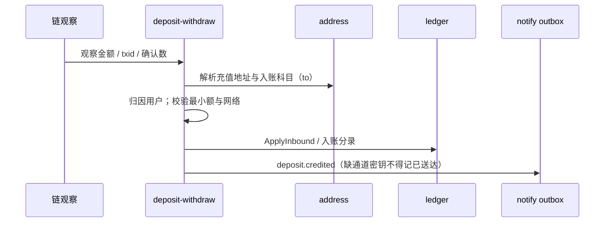
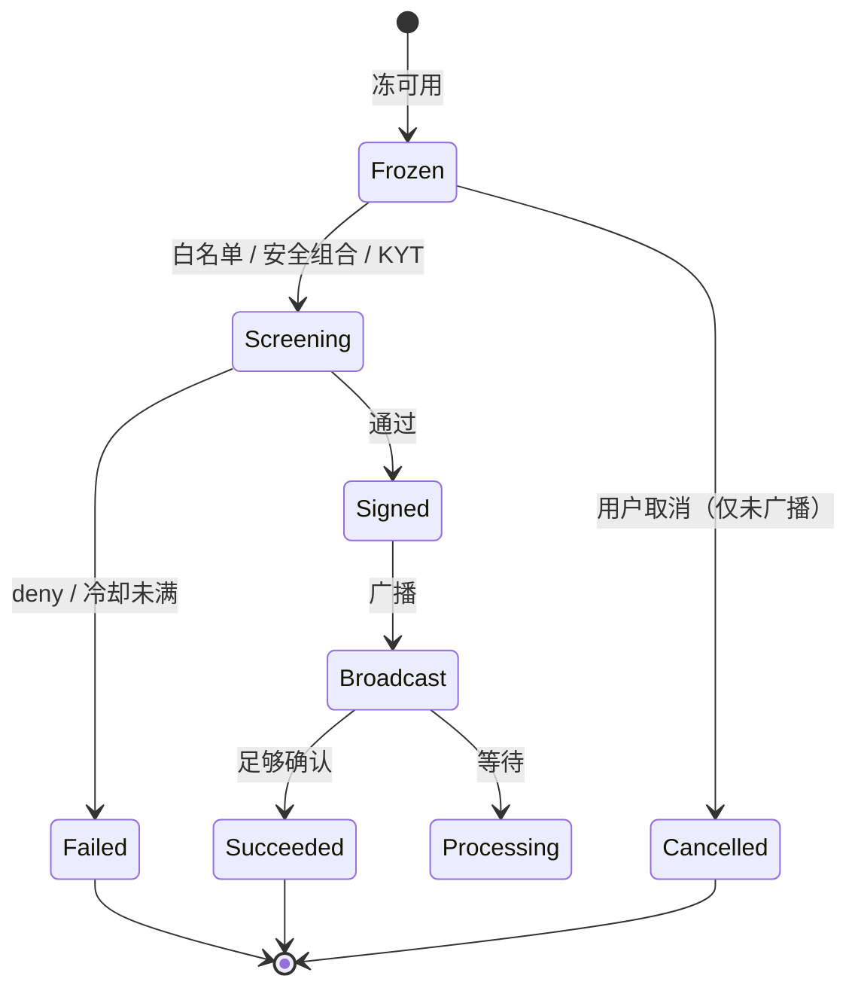
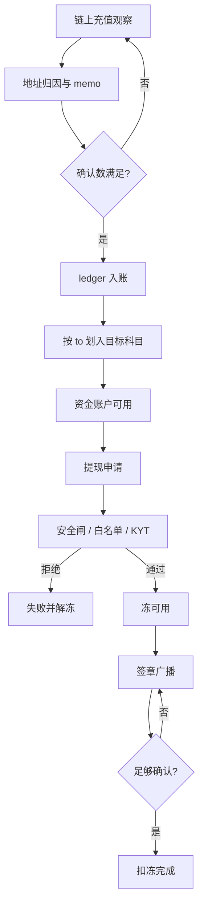

# 充值与提现流水线

本文描述链上充值观察入账与提现冻账到广播的主干。实现分散在 `deposit-withdraw` 相关包、`internal/ledger`、地址与 KYT 服务；HTTP 兼容面见 `internal/kcfund`。

## 充值

要点：

- 入账科目以创建地址时记录的 `to` 为准（MAIN / TRADE 等）。
- 提前入账字段与确认进度写入充值历史；不得伪造确认数。
- 错网 / 错 memo 走恢复工单路径，不在观察线程静默入账。
- 站内内部转入可写入充值历史视角，与链上充值区分 `isInner`。

## 提现

闸门（失败即关，禁止跳过）：

| 闸门 | 说明 |
| --- | --- |
| 科目 | 直接出金仅 MAIN / TRADE；其他科目须先划转 |
| 交易密码 | 已设置则必核 |
| 验证组合 | 配置 `WITHDRAW_VERIFY_COMBOS`（如手机+交易密码，或邮箱+TOTP+交易密码） |
| 地址簿 / 白名单 | 开启后地址与链必须命中收藏地址 |
| 安全变更冷却 | 改绑 2FA / 密码等后的禁提窗口 |
| KYT | allow / review / deny；deny 不得广播 |
| 额度与手续费 | 预览实到账；UTA/经典额度按配置 |

## 与查询面的关系

- 历史：`GET` 充提列表支持币种、状态、`isInner`、CSV 窗口。
- 冻结明细：挂单、待提现、P2P 占用等分类展示；park 在 bridge 的不计入用户 Frozen。

## 卡住广播收尾

`withdraw.RecoverStuck` 针对**广播跟踪**卡住单（非 ledger 无 hash 冻账，那条已由 `ledger.RecoverStuck` 处理）：

- signed 且从未带 `tx_hash`：走出金 Cancel 解冻，广播标 Failed。
- 已有 live hash（broadcast / confirming / reorg）：**拒绝自动解冻**，须走 Observe / Confirm。
- fee_bump：只分类返回，不造替换链上交易。

`BindFundsRecon` 在孤儿 holdcat 清扫之后调用 `SweepStuck`（默认 TTL 30m、limit 200），周期收尾 signed-never-broadcast；live hash 永不自动解冻。

## 相关文档

- [资金页业务流](aa-funding-page-flows.md)
- [资金单据状态机](fund-state.md)
- [科目与账本落点](book-subject.md)
- [API 基线](aa-funding-api-baseline.md)
- [能力矩阵](../product/funding-capability-matrix.md)

## 充提闭环

充值入账与提现出金共用账本科目与冻结位；中间不得跳过确认深度或安全闸。

热钱包异常时 `custodyhalt` 同时挡住充值确认与提现申请；对账漂移经 `ApplyFreezeOnDrift` 冻账户后，须人工解冻，清扫不得自动解除停提。
