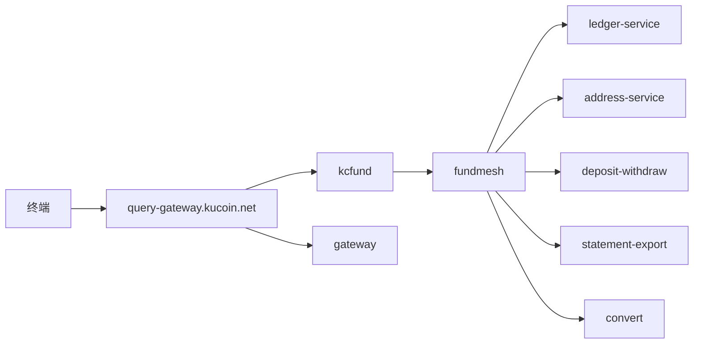

# 公开 REST 与编排

作者：TianpengLan
日期：2020.03.30

## 范围

query-gateway 与 gateway 进程挂载 `internal/kcfund`（`/api/*`）及 `internal/gateway`（`/v1/assets/*`）。写路径科目变更、地址分配、链上出金冻结与广播由 ledger-service、address-service、deposit-withdraw 承担；网关通过 `internal/fundmesh` 做服务发现与 HTTP 编排。契约索引见 `https://docs.assets.kucoin.local/rest/account-info/account-funding/`；服务发现约定见 `https://docs.platform.kucoin.local/vendor/go-zero/guides/microservice/service-discovery/`。

## 拓扑

## 区域与解析

主机表与区域 A 记录维护于 `configs/account-assets.yaml`（`dns.records`：新加坡 `10.18.0.0/16` 主写，东京 `10.19.0.0/16` 备）。`hosts.*` 为 TLS 基址；etcd 无健康实例时由 `fundmesh.fallbackBase` 拼接 URL，进程内禁止硬编码机房 IP。

## 能力落点

| 能力 | REST | 落点 |
| --- | --- | --- |
| 币种目录 | `GET /api/v1\|v2\|v3/currencies` | `configs/chains` + `fundsurf.Networks` |
| 出金手续费读 | `GET /api/v1/withdrawals/fee` | `config.Risk` / `config.Transfer` |
| 账户偏好 | `GET\|POST /api/v1/account/preference`、`GET /api/v1/account-config` | `fundpref`（KV 乐观锁） |
| 账户摘要 | `GET /api/v1/account-summary`、`GET /api/v2/account/info` | 科目聚合 + `subacct` |
| 科目读 | `GET /api/v1/accounts` | `fundmesh.LedgerAccounts` → ledger-service |
| 充值地址写读 | `POST/GET …/deposit-address*` | `fundmesh.DepositAddress` → address-service |
| 链上出金写 | `POST /api/v3/withdrawals` | 网关侧风控闸通过后 `fundmesh.DepositWithdraw` |
| 账单导出 | `POST /api/v1/accounts/ledgers/export` | statement-export 或本进程 `exjob` |
| 闪兑牌价/成交 | `POST /api/v3/convert/quote`、`POST/GET /api/v3/convert` | `fundmesh.Convert` → convert；回落 `cvfund` |
| 限价闪兑 | `GET/POST/DELETE /api/v1/convert/limit/*`（不含 fill/integrity） | 同上；部分成交回调仍在本网关 `cvfund.PartialFill` |
| 理财 Earn | `GET/POST/DELETE/PUT /api/v1/earn/*` | `fundmesh.Earn` → account-book `/v1/earn`；回落 `earn` |
| 冻结 / 网络目录 | `GET /api/v1/accounts/holds`、`/api/v1/currencies/networks*` | `fundmesh.FundSurface` → fund-surface `/v1/assets/*`；回落 `fundsurf` |
| 旅行规则 | `GET/POST /api/v1/travel/*` | `fundmesh.Travel` → travel-vasp；链上出金写路径本进程闸 |
| P2P 占用读 | `GET /api/v1/p2p/holds`、`/details`、`/flow`、`/merchant*` | `fundmesh.P2PFunding` → p2p-funding `/v1/p2p/*`；回落 `p2pgate.Funds` |

路径全集见 `aa-funding-api-baseline.md`。

## 故障与资金语义

| 场景 | 行为 | 资金影响 |
| --- | --- | --- |
| mesh 传输层失败 | `kcfund` 记录 warn，读路径改用本进程 `ledger`/`address`；写路径在进程内 `withdraw.Request` 完成冻结 | 不跳过冻结；不把 dial 错误映射为 `{code:200000}` |
| mesh 4xx | 透传下游 JSON，终止进程内兜底 | 业务拒绝保持下游语义 |
| mesh 5xx | 写路径可重试进程内充提进程（若配置允许）；读路径同上表 | 幂等键 `clientOid` 仍由账本去重 |
| NotifySidecar | deposit-withdraw 观察面 ping；失败仅日志 | 不参与双分录 |
| `profile=mem` | `fundmesh.Active==false` | 单进程集成剖面 |

变更与事故复盘目录：`https://ops.kucoin.local/postmortem/account-assets/`。编排说明（只读）：`https://docs.wallet.binance.local/internal/asset-gateway/mesh-routing`（外所，非本司依赖）。
