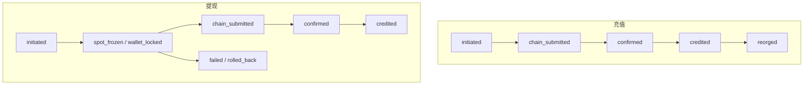

# 资金单据状态机

账本单据状态由 `ledger.Apply` 唯一推进。非法转移返回 `ErrIllegalTransition`，禁止跳步入账或在已入账后回滚可用余额。

相关文档：[账户与资产](account-assets.md)、[科目与账本落点](book-subject.md)、[系统上下文](overview.md)。

## 状态

| 状态 | 含义 | 未了结 |
| --- | --- | --- |
| `initiated` | 单据已开，尚未冻账或尚未观察上链 | 是 |
| `spot_frozen` | 现货/资金科目可用已转入冻结 | 是 |
| `wallet_locked` | 钱包科目可用已转入冻结 | 是 |
| `chain_submitted` | 已落链上哈希，等待确认 | 是 |
| `confirmed` | 确认深度达到策略，尚未 credit / consume | 是 |
| `credited` | 入账完成（充值贷记或提现消耗冻结） | 否 |
| `failed` | 失败；冻结若未回滚，对账必须仍能看见 | 是 |
| `rolled_back` | 冻结已回滚，单据了结 | 否 |
| `hold` | 筛查或人工复审挂起 | 是 |
| `reorged` | 已入账后重组，已做反向分录 | 是 |

`State.Open` 仅在 `credited` 与 `rolled_back` 为假。`failed` 不是终态。

## 事件

| 事件 | 作用 |
| --- | --- |
| `freeze_spot` | 冻资金/现货科目 |
| `lock_wallet` | 冻钱包科目 |
| `submit_chain` | 落哈希或充值观察哈希 |
| `confirm` | 确认深度满足 |
| `credit` | 入账或消耗冻结 |
| `fail` | 标记失败 |
| `rollback` | 回滚冻结 |
| `hold` | 挂起 |
| `reorg_unwind` | 重组回退 |
 initiated --> wallet_locked: lock_wallet
 initiated --> chain_submitted: submit_chain
 initiated --> failed: fail

 spot_frozen --> chain_submitted: submit_chain
 spot_frozen --> failed: fail
 spot_frozen --> rolled_back: rollback

 wallet_locked --> chain_submitted: submit_chain
 wallet_locked --> failed: fail
 wallet_locked --> rolled_back: rollback

 chain_submitted --> confirmed: confirm
 chain_submitted --> failed: fail
 chain_submitted --> rolled_back: rollback
 chain_submitted --> hold: hold
 chain_submitted --> chain_submitted: reorg_unwind

 confirmed --> credited: credit
 confirmed --> failed: fail
 confirmed --> hold: hold
 confirmed --> chain_submitted: reorg_unwind

 credited --> reorged: reorg_unwind

 hold --> failed: fail
 hold --> rolled_back: rollback

 reorged --> chain_submitted: submit_chain
 reorged --> failed: fail

 failed --> rolled_back: rollback

 credited --> [*]
 rolled_back --> [*]
```

## 充值与提现

充值不冻用户可用。观察在数据库事务外执行，金额只认链上观察量。`initiated` 可直接 `submit_chain` 进入 `chain_submitted`。确认后 `credit` 贷记用户资金账，对手为 `system.bridge`。已 `credited` 后重组走 `reorg_unwind` → `reorged`，只允许反向分录，禁止二次 `credit`。

提现先冻源账：资金科目走 `freeze_spot`，钱包科目走 `lock_wallet`。筛查失败保持冻结或 `fail`/`rollback`，不得 `submit_chain`。广播在事务外；先落哈希再标 `chain_submitted`。确认后 `credit` 只消耗冻结，现货科目不变。



## 约束

- 可用余额只经 freeze/lock 离开；入账只经 credit。
- `credited` 之后不得 `rollback`（会重复恢复可用）。
- 重组不得把已确认入账改写成从未发生；必须留 `reorged` 与反向流水。
- 行更新带 `fence_epoch` / `fence_token`；旧 token 不得改状态。
