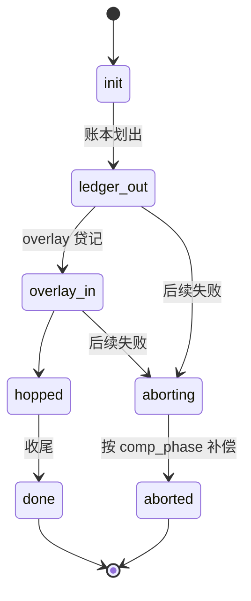
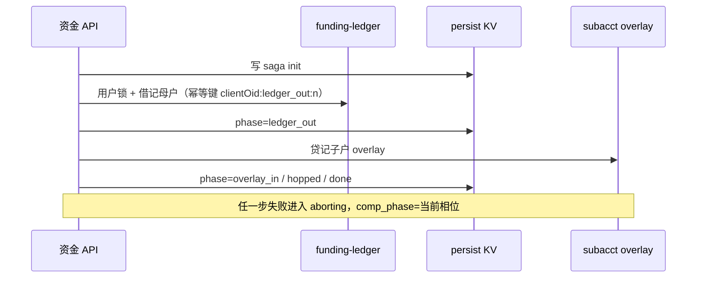

# 母子资金 Hop Saga

本文描述母账户与子账户之间资金 hop 的逐步提交、补偿与崩溃恢复。实现见 `internal/kcfund/hop.go`；子户账面 overlay 见 `internal/subacct`。

## 边界

- 账本与 overlay 不在同一条 SQL 事务内。一致性依赖：用户锁、KV 相位、幂等键、失败补偿。
- 环境禁止在缺 Redis 用户锁时跳过锁写账。
- 同 `clientOid` 重试可续跑未完成相位；已冲正的跳次递增幂等后缀，避免回放已入账分录。

## 相位

| 相位 | 含义 |
| --- | --- |
| `init` | 已受理，尚未动账 |
| `ledger_out` | 源侧账本已借记（或已冻后划出） |
| `overlay_in` | 目标 overlay 已贷记 |
| `hopped` | 正向路径完成待收尾 |
| `overlay_out` / `ledger_in` | 反向 hop（子→母）对称相位 |
| `done` | 终态成功 |
| `aborting` | 失败进入补偿；`comp_phase` 记录失败前所达相位 |
| `aborted` | 补偿完成 |

`aborting` 必须携带 `comp_phase`。恢复时按失败相位冲正，禁止默认按 `hopped` 去 `ReverseHop` 误扣从未贷记的 overlay。

## 正向（母 → 子）

## 崩溃恢复

1. 新进程启动：`Hydrate` 按 `ListAfter` 游标装入 overlay 与未完成 saga，禁止只读进程内存。
2. `RecoverOpenHops`：扫描开放 saga，持用户锁续跑或补偿。
3. recon-worker：`POST /v1/recon/hops/recover`；`BindFundsRecon` 挂入 `workerTick` 周期调用。
4. 运维依赖：进程死后若无人扫且无人用同 `clientOid` 重试，半边会停在 KV 相位，直到扫回。这不是永久分叉，但是恢复路径上的运维约束。

## 不变量

| 项 | 约定 |
| --- | --- |
| 用户锁 | 整段 hop 持同一用户锁 |
| 幂等 | 正向分录与冲正分录键分离；冲正后 ForgetPost 允许同逻辑单再试 |
| 失败 | 不得向调用方返回成功后留下可接着动用的半截 hop |
| 观测 | 恢复结果写 metrics（ok / error / skip） |

## 相关代码

- `internal/kcfund/hop.go` — `HopFunds`、`RecoverOpenHops`、`BindFundsRecon`
- `internal/subacct` — overlay 账面
- `internal/reconhttp` — 人工/任务触发恢复入口
- `internal/app/app.go` — `workerTick`
