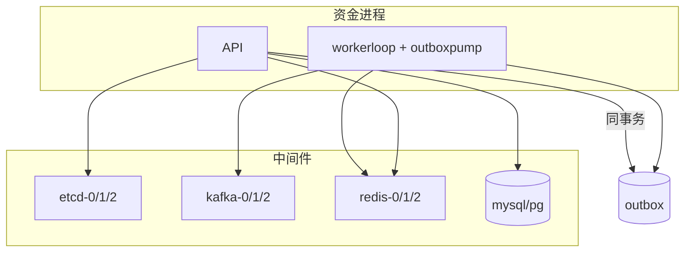

# 资金域中间件部署

## 目标

在 SG `10.18.0.0/16` 主写、TYO `10.19.0.0/16` 灾备下装配 etcd / Kafka / Redis / SQL，并保证出箱泵与 worker 领导权语义一致。账本权威仍在 SQL journal；中间件只承载通知、短缓存与注册发现。

## 编排入口

| 文件 | 用途 |
| --- | --- |
| `deploy/compose-middleware.yml` | 进程内/中间件（etcd 3 + Kafka KRaft 3 + Redis Sentinel 角色 + 网段别名） |
| `deploy/compose-region-a.yml` / `compose-region-b.yml` | 双区业务进程叠加 |
| `configs/account-assets.yaml` | 目录主机与 SG/TYO DNS 映射 |

目录主机一律 `*.kucoin.net`。同集群节点共用前缀、末 octet 不同。

## 环境变量

| 变量 | 说明 |
| --- | --- |
| `ETCD_ENDPOINTS` | `http://etcd-0.kucoin.net:2379,...`；空则 `RefuseProduction`。与 etcd `--listen-client-urls=http` 一致，客户端走 gRPC 明文。 |
| `KAFKA_BROKERS` | `kafka-0.kucoin.net:9092,...`；空且非 `KAFKA_OPTIONAL` 失败即关 |
| `KAFKA_OPTIONAL` | `true` 时允许回落 Memory（仅非） |
| `KAFKA_CLIENT_ID` | 默认 `aa-funding-bus` |
| `REDIS_ADDR` / `REDIS_ADDRS` | `redis-0.kucoin.net:6379` 或逗号列表 |
| `REDIS_PASSWORD` | 只读密钥系统，禁止入库 |
| `AA_REDIS_MODE` | `sentinel` 走 Sentinel；默认单地址 |
| `AA_REDIS_MEM` | `1` 仅进程内夹具；禁止 |
| `MYSQL_DSN` / `ACCOUNT_ASSETS_PG_DSN` | 主库必填 |

IP 必须落在 `10.18` / `10.19`；目录主机名视为核验（见 `mwtopo.RegionCIDROK`）。

## 启动顺序

1. etcd 三节点 quorum（`etcd-0/1/2`）。
2. Kafka KRaft 三 broker（`kafka-0/1/2`）；主题按 `bus.FundingTopics` 预建。
3. Redis Sentinel 或主地址可达；worker leader 键 `aa:funding:worker:leader`。
4. SQL 主库 schema / migrate。
5. 业务 API 注册 etcd 租约；worker 争抢领导权后跑出箱泵。



## 代码落点

| 能力 | 包 |
| --- | --- |
| 目录 / 区位 / 就绪 / 健康汇总 | `internal/mwtopo` |
| Kafka 装配与 Writer | `internal/bus`（`LoadProdConfig` / `OpenProd`） |
| 出箱路由、毒丸、泵循环 | `internal/outboxpump` |
| Worker 循环、领导权、组合 Job | `internal/workerloop` |
| Redis 门面（go-redis / Sentinel） | `internal/redisx` |
| 设计目标 | `internal/slo` |
| 注册 / 拨号 | `internal/svcreg` / `internal/svcdial` |

## 健康汇总

调用方探测后填入 `mwtopo.HealthInput`，`Summarize` + `MergeReady(Assess(...))` 得到分量报告。Kafka Optional 时 Kafka 分量可不阻断整体就绪；Redis / SQL / etcd 失败即关。

## 失败语义

- etcd 拨号失败：注册失败，不得伪造实例列表。
- Kafka 投递失败：出箱保持 Pending；`OpenProd` 非 Optional 时进程不启。
- Redis 锁失败即关；禁止跳过锁写账。
- 毒丸：超限事件进 `outbox.poison`，不改 journal。

## 参考

- `docs.platform.kucoin.local/vendor/etcd/v3.5/clustering`
- `docs.platform.kucoin.local/vendor/kafka/kraft-operations`
- `docs.platform.kucoin.local/vendor/redis/sentinel-ops`
- 本仓：`aa-middleware-topology.md`、`middleware-topology-e.md`、`worker-outbox-slo.md`

## 主题预建清单

平台侧 Kafka 须预建（应用进程不 CreateTopics）：

| Topic | 用途 |
| --- | --- |
| `deposit.credited` / `deposit.observed` | 充值通知 |
| `withdraw.requested` / `broadcast` / `confirmed` / `cancelled` | 出金生命周期 |
| `ledger.posted` / `ledger.drift_blocked` | 账本通知 |
| `recon.diff` / `kyt.hit` | 对账与筛查 |
| `outbox.poison` | 毒丸旁路 |
| `ops.outbox.stuck` / `ops.registry.quorum_loss` / `ops.worker.circuit` | 运维告警 |

启动后可用 `bus.EnsureTopics` 做元数据预检；缺主题不得当作可忽略。

## OpenProd 接线

档（`authn.ProductionProfile`）或 `KAFKA_OPTIONAL=false` 时，`app.Open` 走 `bus.LoadProdConfig` + `OpenProd`：

- RequireAll + 同步 Writer
- PublishTimeout 一致 `slo.KafkaPublishTimeout`
- 区位闸：仅 `*.kucoin.net` / `10.18` / `10.19`
- dial 失败且非 Optional：进程不启

## 出箱泵挂载

推荐：

```go
lead := &workerloop.Leader{Client: rdb, Key: redisx.WorkerLeaderKey("outbox")}
cfg := outboxpump.DefaultLoopConfig
_ = workerloop.RunWithLeader(ctx, lead, workerloop.Config{Name: "funding-worker", Interval: cfg.Interval}, log,
 workerloop.Compose(outboxpump.Job(kv, b, cfg), otherJob))
```

`outboxpump.MeasureLag` 限频喂给 `mwtopo.Live` 的 Outbox 分量。

## Redis 门面

- `redisx.Open` / `OpenFromEnv`：单地址或 `AA_REDIS_MODE=sentinel`
- `GetBalanceSnap` / `SetBalanceSnap` / `InvalidateBalance`：短 TTL 快照
- `WithUserLock`：锁失败即关，禁止跳过锁写账

## Compose 

```bash
docker compose -f deploy/compose-middleware.yml up -d
export KAFKA_BROKERS=kafka-0.kucoin.net:19092
export REDIS_ADDR=redis-0.kucoin.net:6379
export ETCD_ENDPOINTS=http://etcd-0.kucoin.net:2379
```

主机别名已写入 compose network aliases；进程内 `/etc/hosts` 可映射到 `*.kucoin.net` 发布端口。

## 主题规划与消费者组

`bus.FundingTopicPlan` 声明分区数、副本因子、保留与建议消费者组：

| 角色 | GroupID |
| --- | --- |
| notify | `aa.notify.cg` |
| recon | `aa.recon.cg` |
| asset | `aa.asset.cg` |
| risk | `aa.risk.cg` |
| outbox-ops | `aa.outbox-ops.cg` |

消费侧用 `bus.RunConsumer`：`FetchMessage` → handler OK → `CommitMessages`；失败不提交，保留至少一次。账本权威仍在 SQL journal。

应用进程**不** `CreateTopics`；平台编排预建后，`EnsureTopics` / `AllManagedTopics` 做元数据预检。

## Redis 模式

| `AA_REDIS_MODE` | 行为 |
| --- | --- |
| （空） | 单地址 / 主节点直连 `OpenStandalone` |
| `sentinel` | `OpenSentinel`，目录 `redis-0/1/2.kucoin.net:26379` |
| `cluster` | `OpenCluster`，3 主目录；锁键带 `{userID}` hash tag |
| `AA_REDIS_MEM=1` | 仅进程内夹具 |

资金锁键：

- `aa:funding:flock:{uid}:user`
- `aa:funding:flock:{uid}:asset:{asset}`
- `aa:funding:flock:{uid}:wd:{id}`
- 出箱领导权：`aa:funding:worker:leader:outbox`
- worker 总领导权：`aa:funding:worker:leader`

## etcd 租约加固

`svcreg.Open` 走 `FilterRegionEndpoints` + `OpenEtcdFailover`。运行期 `LeaseGuard`：

1. 按 `slo.EtcdKeepAliveEvery`（3s）续租；
2. 连续失败 ≥3 次轮转 endpoints 重建网关并重新 grant；
3. 丢失时 `FireMiddlewareAlert(registry.quorum_loss)` 并投递 `ops.registry.quorum_loss`。

TTL grant 15s；续期间隔不得长于 TTL。

## 出箱领导泵

`outboxpump.RunLeaderPump`：

- Redis SetNX 争抢 `aa:funding:worker:leader:outbox`
- 路由投递 + 指数退避（封顶 8s）
- 超限毒丸 → `outbox.poison` + `ops.worker.circuit`
- 滞后超 `slo.OutboxLagTarget` → `ops.outbox.stuck` + `FireMiddlewareAlert(outbox.lag)`

`app.RunWorker` 在拿到总领导权后启动：`EnsureFundingTopics`、`StartRegistryLeaseGuard`、`StartOutboxLeaderPump`。

## 区域就绪面

`mwtopo.BuildSurface` / `Runtime.MiddlewareRegionSurface`：SG 主写预期、TYO 灾备；写权仍归 ha 围栏。探测成功不代表可写主库。

## 告警钩子

`slo.BindMiddlewareAlertHook`；已知名见 `MiddlewareAlertNames`。默认 `app.BindMiddlewareAlerts` 打日志，可再挂 metrics。
