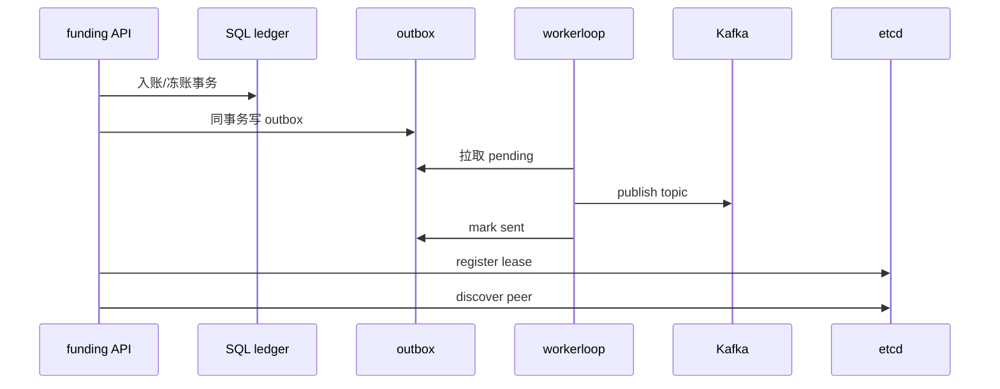

# 资金域中间件拓扑（E 批实现）

作者：Axel
日期：2020.04.06

本页只描述 **E 批**在代码中的接线与失败语义。节点表、主题清单、Worker 时序见 `aa-middleware-topology.md`；SLO 常量见 `worker-outbox-slo.md`；Compose 与告警见 `middleware-deploy.md`。

## 目标

为账户资金微服务提供注册发现、消息投递、短缓存与后台 worker 骨架。账本权威仍在 SQL；中间件不得替代复式分录。

## 数据流

## 失败语义

- etcd 拨号失败：注册失败，进程可只读降级，不得伪造实例列表。
- Kafka 投递失败：outbox 保持 pending，worker 退避；不得改账本状态冒充已通知。
- Redis 锁/读失败：穿透到 SQL；不得返回空余额冒充成功。

## Open 路径

1. `RefuseProduction`：etcd / Kafka / Redis / SQL 区位闸。
2. `bus.OpenProd`：RequireAll Writer + DialProbe。
3. `svcreg.Open` → `OpenEtcdFailover`。
4. `attachPlatform`：`BindMiddlewareAlerts`。
5. `RunWorker`：`EnsureFundingTopics` + `StartRegistryLeaseGuard` + `StartOutboxLeaderPump`。

接线要点：`bus.LoadProdConfig` → `OpenProd`；`redisx.Open` / `OpenFromEnv`；出箱 `outboxpump.RunLoop` 或 `Job` 挂入 `workerloop`；领导权 `workerloop.Leader` + `redisx` SetNX；健康 `mwtopo.Summarize` + `MergeReady`。

## 代码落点

| 包 | 职责 |
| --- | --- |
| `internal/bus` | Kafka /消费、主题规划、预检 |
| `internal/outboxpump` | 出箱泵、退避、毒丸、领导权、lag |
| `internal/workerloop` | 循环、熔断、领导权、统计、Observe |
| `internal/redisx` | 单机/Sentinel/Cluster、资金锁键 |
| `internal/svcreg` / `internal/svcdial` | etcd 注册续租与拨号熔断 |
| `internal/mwtopo` | 目录、就绪、健康、区域面 |
| `internal/slo` | 设计目标与中间件告警钩子 |

账本 journal 仍是入账权威；中间件只负责通知、短缓存与发现。
