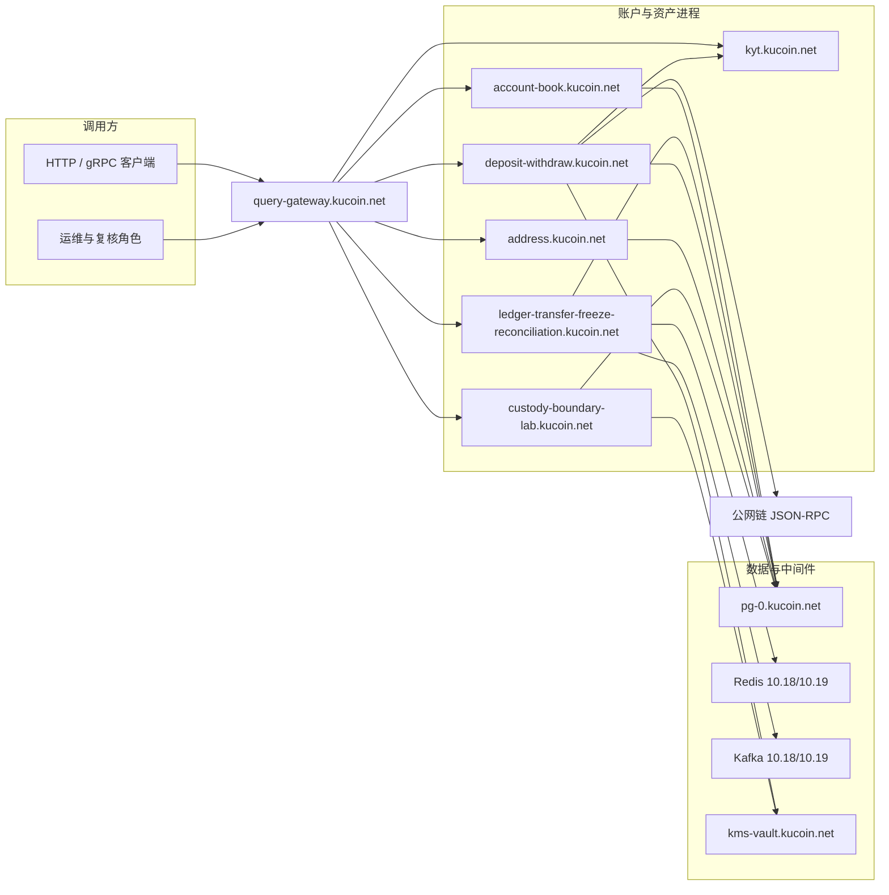

# 系统上下文与限界上下文

本文描述账户与资产后端的进程边界、科目边界与外部依赖。范围限于账户与资产写路径及只读查询；现货撮合集群与行情不在本文展开。

相关文档：[账户与资产](account-assets.md)、[持久化](persistence.md)、[部署与双活](deployment.md)、[资金单据状态机](fund-state.md)、[科目与账本落点](book-subject.md)、[母子 Hop Saga](hop-saga.md)、[补账与对账](cover-and-reconcile.md)、[充提流水线](deposit-withdraw-pipeline.md)。进程拆分表见 [`../account-assets-architecture.md`](../account-assets-architecture.md)。

## 系统上下文

客户端经 query-gateway 访问各资金进程。服务间与写路径主机名落在 `*.kucoin.net`；数据面网段 SG `10.18.0.0/16`（主写）、TYO `10.19.0.0/16`（灾备读）。链节点 URL 由配置注入，出站前经 `rpcallow` 白名单校验，避免进程内硬编码外连。

**系统上下文**

## 限界上下文

| 上下文 | 职责 | 不包含 |
| --- | --- | --- |
| 账户科目 | funding / trading / margin / futures / earn 开闭冻、合法 hop | 撮合、强平、合约引擎 |
| 账本 | 复式分录、冻结、幂等、对账、行级 fence | 链上广播本身 |
| 充值 | 观察金额入账、归因、确认深度、重组回滚 | 调用方自报入账额 |
| 提现 | 冻账 → 白名单 → 策略/分值/KYT → 签名 → 广播 | 筛子出错后的放行 |
| 地址 | 派生、唯一绑定、冷却回收、出金地址册 | 任意现场派生串户 |
| 托管边界 | `system.bridge` / `system.cold`、双人审批、按次解包签名 | 托管牌照或硬件集群认证 |
| 筛查 | allow / review / deny、案件、只追加审计 | 持牌核验证明 |
| 查询 | 统一余额、流水、多科目对账单 | 写路径副作用 |
| 金库 | 热账上限、归集计划、浮动停写 | 链上归集执行器认证 |
| 子账户 | 母户/子户资金账、级联冻结、母↔子 hop | 子户之间直跳 |

`cmd/api` 可将上述路由挂在同一进程，供单进程检出。拆分二进制由 compose 配置 `apps` 拉起，目录主机名不变。

## 共享不变量

| 不变量 | 约定 |
| --- | --- |
| 金额 | `DECIMAL(36,18)`；用户入参拒科学计数与非正；账面余额允许 0、拒负 |
| 守恒 | hop、切费、入账后 `money.Conserve`；复式按资产轧平，不平整批拒绝 |
| 冻结后移动 | 可用余额只经 freeze/lock 离开；入账只经 credit |
| 幂等 | `idempotency_key` + 载荷哈希；冲突映射 409 |
| 围栏 | 行更新带 `fence_epoch` / `fence_token`；旧 token 不得改行 |
| 选主 | 双区无主或脑裂时写失败即关 |
| 链 RPC | Observe / Submit / Status 在数据库事务外 |
| 充值额 | 只认链上观察量，不认请求猜测 |
| 筛查 | 出错、拒绝或复审未决均不得广播 |

## 接口原则

- 领域错误在 `internal/ledger`、`pkg/money` 等包定义；HTTP/gRPC 状态由 `internal/apierr` 映射，处理器不得按业务文案选状态码。
- 账本对链的唯一出口为 `ledger.ChainBridge`（Submit / Status / Observe / Inspect）。
- 出站 URL 只放行目录主机或公网 HTTPS；回环与自造主机名拒绝。
- 角色经 `X-Actor` / `X-Role`：托管签名、典礼、KYT 裁决、运维写不是默认用户授权。
