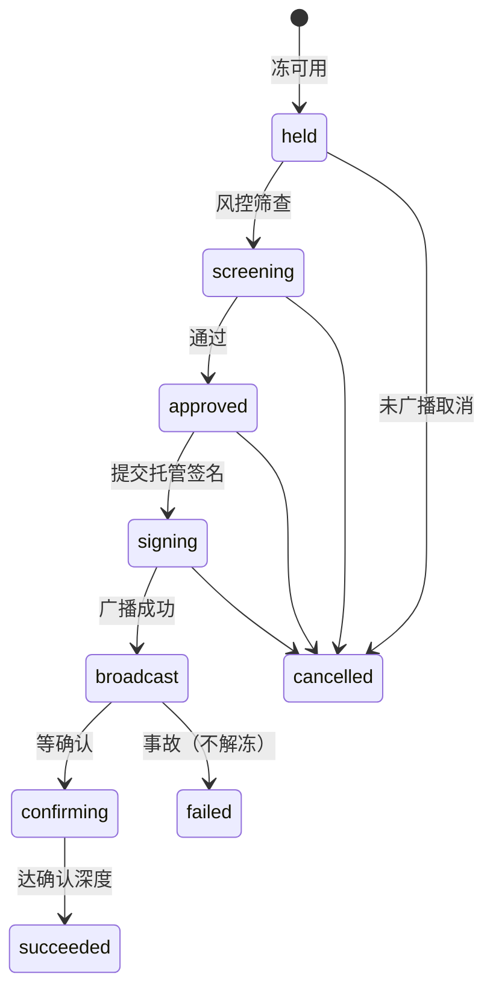

# 出金冻结、幂等与对账基线

## 冻结状态机

未广播状态允许取消并解冻。广播后禁止解冻，失败走事故台。

## 幂等

- 表 `aa_idempotency_key`：`(scope, idem_key)` 唯一。
- 同 key 同意图（fingerprint）重放返回原 `ref_id`。
- 同 key 不同意图返回冲突。
- 路径必须 SQL 实现；内存实现仅夹具。

## 对账漂移

- 账本与流水轧差失败时写入 `aa_ledger_drift_block`。
- 未清阻断拦截新冻。
- 解封须 actor/note，留审计。

## 广播守恒与事故口径

冻结位、广播跟踪、热出金意图三者不一致时开 `conserve` 工单，并只阻断该用户该资产的新出金。live hash 禁止自动与批量解冻。半冻结只接着原单或转事故。刷提键前缀为 `wd:`。细则与验收夹具见 `docs/product/wd-freeze-broadcast-conserve.md`。

## 配置区位

内部中间件与数据面主机落在新加坡 `10.18.0.0/16` 与东京 `10.19.0.0/16`（以新加坡为主），域名走 `*.kucoin.net`。
